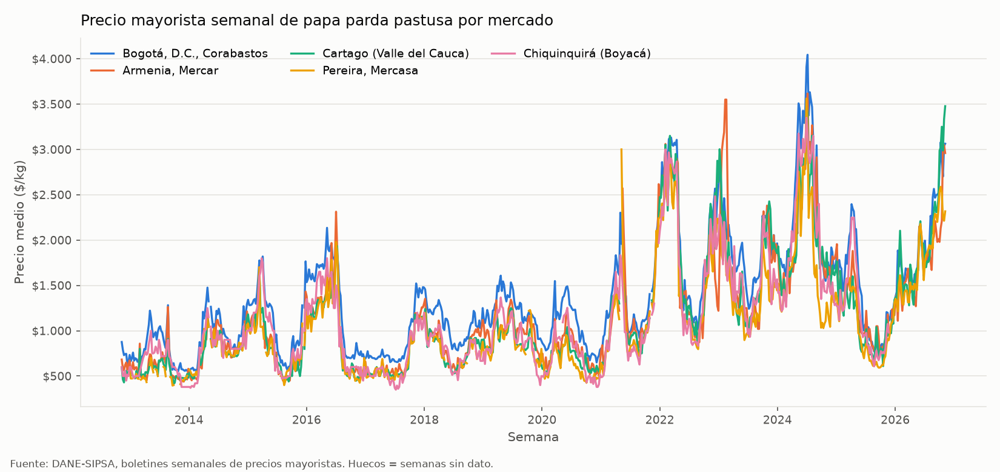
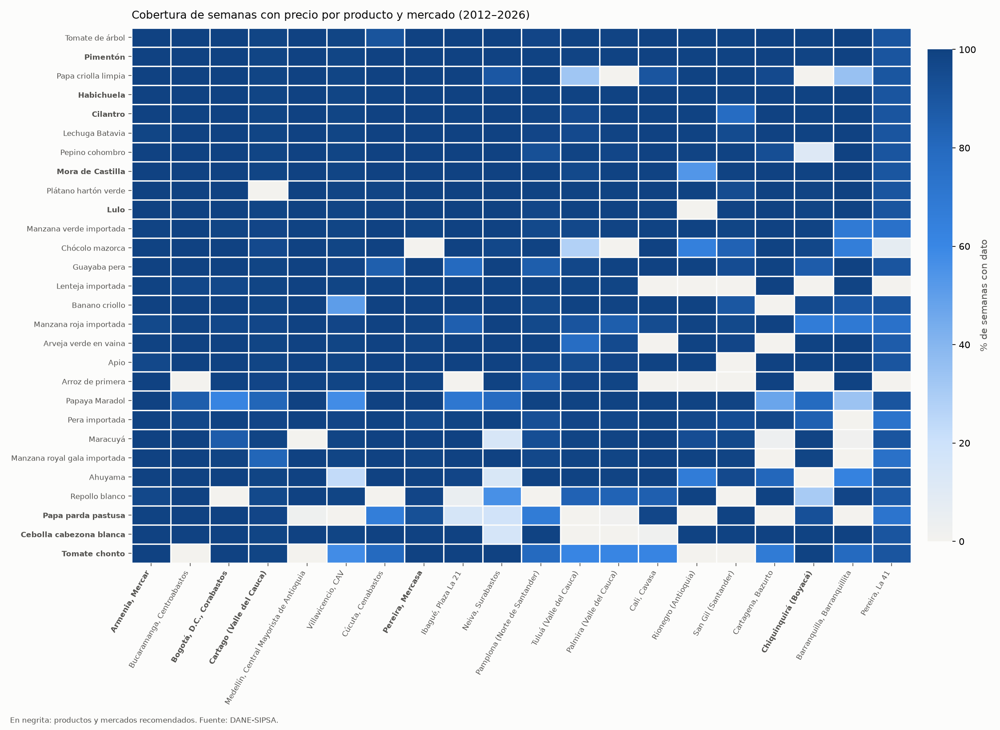
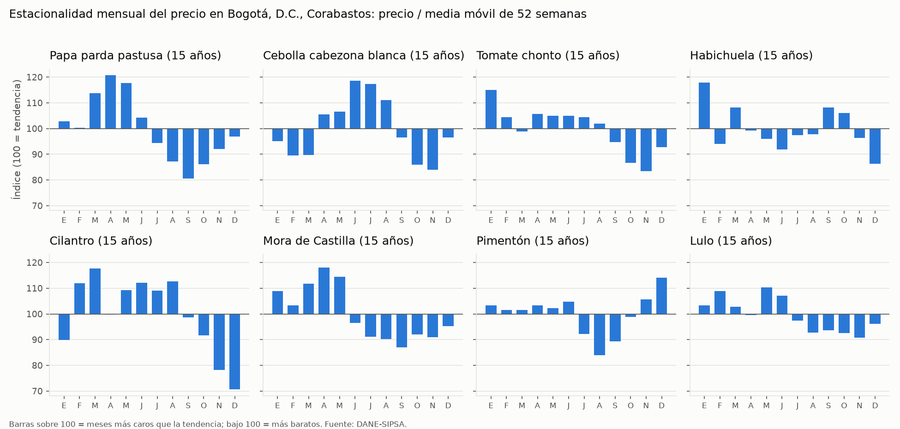
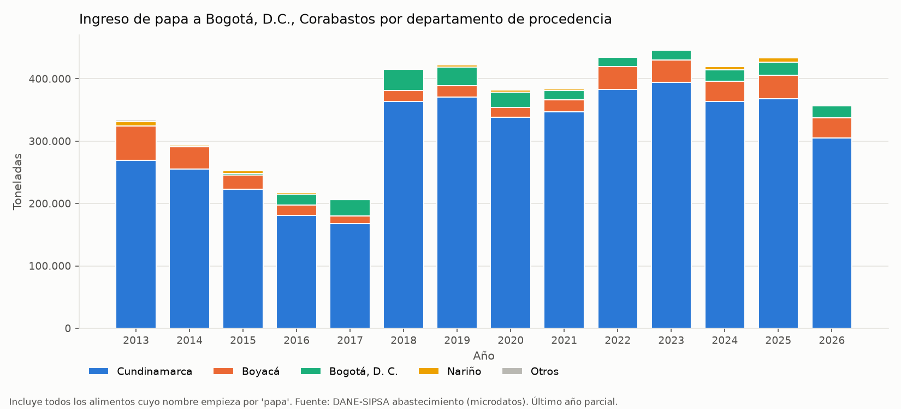

# Exploración de datos SIPSA (DANE)

_Generado automáticamente por `scripts/explore_sipsa.py` el 2026-11-15. Todas las cifras salen de los archivos descargados en `data/raw`; lo que no se pudo determinar se marca como **desconocido**._

## 1. Fuentes descargadas

| Fuente | Descripción | Archivos |
|---|---|---|
| prices_weekly | Anexos de los boletines semanales de precios mayoristas (mín., máx. y medio por producto y mercado) | 729 |
| prices_monthly | Series históricas de precios mayoristas (precio promedio mensual por producto y mercado) | 10 |
| supply | Abastecimiento: serie histórica agregada + microdatos anuales por mercado, origen y alimento | 15 |

La página del componente de precios mayoristas solo publica, en «Información histórica», páginas mensuales con los **boletines diarios**. La serie semanal se reconstruyó con los anexos de los boletines semanales (2012–2026), que tienen precio mínimo, máximo y medio por producto y mercado. También se descargaron las series históricas mensuales oficiales (2013–2026) como referencia. No se descargaron los anexos diarios porque existe la serie semanal.

## 2. Precios mayoristas semanales

- Archivos procesados: **729**; con datos: **729**; sin datos legibles: **0**; sin fecha interpretable: **1**.
- Rango de fechas: semana que termina el **2012-11-16** a la que termina el **2026-11-13** (frecuencia semanal, sábado a viernes según las etiquetas de DANE).
- Filas (producto × mercado × semana): **3.274.754**
- Semanas calendario en el rango: 731; semanas sin ningún archivo: **3**.
  - Semanas faltantes (fecha de cierre, primeras 25): 2014-05-16, 2015-12-18, 2021-11-12
- Día de cierre de la semana según la etiqueta: viernes (699), jueves (14), miércoles (14), sábado (1). Las semanas cortas o largas coinciden con festivos (Semana Santa, fin de año); cada archivo se asigna a la semana sábado–viernes de su fecha de cierre (si la etiqueta cierra en sábado se toma el viernes anterior).
- Etiquetas con más de 7 días (probable error de DANE): `Anexo_Bol_Semanal_SIPSA_abril5_2013.xls` → «28 de marzo al 5 de abril de 2013»; `Sem_01may_2020__08may_2020.xlsx` → «01 de mayo de 2020 - 08 de mayo de 2020»; `Sem_07ago_2020__14ago_2020.xlsx` → «07 de agosto de 2020 - 14 de agosto de 2020»; `Sem_11abr_2020__17abr_2020.xlsx` → «09 de abril de 2020 - 17 de abril de 2020»; `Sem_13abr_21abr_2017.xls` → «13 de abril - 21 de abril de 2017»; `Sem_1may_8may_2015.xls` → «1 al 8 de mayo de 2015»; `Sem_20jul__27jul_2018.xlsx` → «20 de julio de 2018 - 27 de julio de 2018»; `Sem_26dic_2020__31dic_2020.xlsx` → «24 de diciembre de 2020 - 31 de diciembre de 2020»; `Sem_30mar_2019__05abr_2019.xlsx` → «30 de marzo de 2019 - 06 de abril de 2019»; `anex_02jul_al_08jul_2022.xlsx` → «01 de julio de 2022 - 08 de julio de 2022»; `anex_19mar_al_25mar_2022.xlsx` → «18 de marzo de 2022 - 25 de marzo de 2022»; `anex_31dic_al_06ene_2023.xlsx` → «30 de diciembre de 2022 - 06 de enero de 2023»; `anex-SIPSASemanal-29mar-04abr-2025.xlsx` → «28 de marzo de 2025 - 4 de abril de 2025»
- Archivos sin fecha interpretable (excluidos): `Anexo_Bol_Semanal_100may10_2014.xls` («Boletín número 100»)
- La fecha de cada archivo se toma del texto que acompaña el enlace en la página de DANE (los nombres de archivo no siguen un patrón: p. ej. `Anexo_Bol_Semanal_abr19_2014.xls`, `Anex_12mar_al_18mar_2022.xlsx`).

### 2.1 Formatos por año

| Año | Archivos | Extensión | Estructura | Hojas | Fila encabezado (más común) | Encabezado | Filas mediana |
|---|---|---|---|---|---|---|---|
| 2012 | 7 | .xls (7) | nested (7) | 2 hojas (7) | 2 | Productos y mercados / Precio mínimo / Precio máximo / Precio medio / Tendencia | 4.082 |
| 2013 | 52 | .xls (52) | nested (52) | 1 hojas (37), 2 hojas (15) | 2 | Productos y mercados / Precio mínimo / Precio máximo / Precio medio / Tendencia | 4.425 |
| 2014 | 51 | .xls (51) | nested (51) | 1 hojas (51) | 2 | Productos y mercados / Precio mínimo / Precio máximo / Precio medio / Tendencia | 4.601 |
| 2015 | 52 | .xls (52) | nested (52) | 1 hojas (52) | 2 | Productos y mercados / Precio mínimo / Precio máximo / Precio medio / Tendencia | 4.567 |
| 2016 | 52 | .xls (52) | nested (52) | 1 hojas (51), 2 hojas (1) | 2 | Productos y mercados / Precio mínimo / Precio máximo / Precio medio / Tendencia | 4.609 |
| 2017 | 52 | .xls (49), .xlsx (3) | nested (52) | 1 hojas (51), 2 hojas (1) | 2 | Productos y mercados / Precio mínimo / Precio máximo / Precio medio / Tendencia | 4.683 |
| 2018 | 52 | .xlsx (44), .xls (8) | flat (33), nested (19) | 1 hojas (19), 9 hojas (33) | 9-10 | Producto / Mercado mayorista / Precio mínimo / Precio máximo / Precio medio / Tendencia | 4.663 |
| 2019 | 52 | .xlsx (52) | flat (52) | 9 hojas (52) | 10-11 | Producto / Mercado mayorista / Pesos por kilogramo / Tendencia / Precio mínimo / Precio máximo / Precio medio | 4.631 |
| 2020 | 53 | .xlsx (53) | flat (49), flat/nested (4) | 9 hojas (49), 10 hojas (4) | 10-11 | Producto / Mercado mayorista / Pesos por kilogramo / Tendencia / Precio mínimo / Precio máximo / Precio medio | 4.530 |
| 2021 | 51 | .xls (35), .xlsx (16) | flat (49), flat/nested (2) | 9 hojas (43), 10 hojas (8) | 10-11 | Producto / Mercado mayorista / Pesos por kilogramo / Tendencia* / Precio mínimo / Precio máximo / Precio medio | 4.437 |
| 2022 | 52 | .xlsx (52) | flat (51), flat/nested (1) | 9 hojas (15), 10 hojas (30), 11 hojas (7) | 10-11 | Producto / Mercado mayorista / Pesos por kilogramo / Tendencia* / Precio mínimo / Precio máximo / Precio medio | 4.384 |
| 2023 | 52 | .xlsx (52) | flat (52) | 10 hojas (41), 11 hojas (11) | 10-11 | Producto / Mercado mayorista / Pesos por kilogramo / Tendencia* / Precio mínimo / Precio máximo / Precio medio | 4.399 |
| 2024 | 52 | .xlsx (52) | flat/nested (6), flat (46) | 9 hojas (1), 10 hojas (39), 11 hojas (12) | 10-11 | Producto / Mercado mayorista / Pesos por kilogramo / Tendencia* / Precio mínimo / Precio máximo / Precio medio | 4.421 |
| 2025 | 52 | .xlsx (52) | flat/nested (12), flat (40) | 10 hojas (40), 11 hojas (12) | 10-11 | Producto / Mercado mayorista / Pesos por kilogramo / Tendencia* / Precio mínimo / Precio máximo / Precio medio | 4.457 |
| 2026 | 46 | .xlsx (46) | flat/nested (11), flat (35) | 10 hojas (35), 11 hojas (11) | 10-11 | Producto / Mercado mayorista / Pesos por kilogramo / Tendencia* / Precio mínimo / Precio máximo / Precio medio | 4.545 |
| desconocido | 1 | .xls (1) | nested (1) | 1 hojas (1) | 2 | Productos y mercados / Precio mínimo / Precio máximo / Precio medio / Tendencia | 4.633 |

- **flat**: columnas `Producto | Mercado mayorista | Precio mínimo | Precio máximo | Precio medio | Tendencia`, una hoja por grupo de alimentos.
- **nested**: una sola columna «Productos y mercados»; una fila con el nombre del producto seguida de las filas de cada mercado; varios «Cuadros» (uno por grupo) en la misma hoja.
- Tipos: nombres de producto y mercado = texto; precios = enteros en pesos colombianos por kilogramo; «Tendencia» = texto (`+`, `-`, `=`, `n.d.`).
- Notas de unidades encontradas en los anexos (no todo es $/kg):
  - «* Los precios reportados para aceite vegetal mezcla, jugo de frutas y vinagre son $/litro»
  - «* Los precios reportados para los huevos son $/unidad.»
  - «* Los precios reportados para aceite, jugo de frutas y vinagre son $/litro»
  - «** Los precios reportados para aceite vegetal mezcla, jugo de frutas y vinagre son $/litro»
  - «** Los precios reportados para los huevos son $/unidad.»
  - «** Los precios reportados para aceite, jugo de frutas y vinagre son $/litro»

### 2.2 Productos y mercados

- Productos distintos (tras unificar mayúsculas/tildes): **403**; mercados: **177**.

| Año | Productos | Mercados |
|---|---|---|
| 2012 | 353 | 80 |
| 2013 | 374 | 100 |
| 2014 | 379 | 83 |
| 2015 | 367 | 86 |
| 2016 | 358 | 87 |
| 2017 | 359 | 77 |
| 2018 | 356 | 85 |
| 2019 | 355 | 79 |
| 2020 | 355 | 79 |
| 2021 | 364 | 109 |
| 2022 | 358 | 105 |
| 2023 | 355 | 116 |
| 2024 | 354 | 103 |
| 2025 | 351 | 85 |
| 2026 | 352 | 81 |

Mercados cubiertos (primera y última semana con dato, número de registros):

| Mercado | Desde | Hasta | Registros |
|---|---|---|---|
| Medellín, Central Mayorista de Antioquia | 2012-11-16 | 2026-11-13 | 152168 |
| Bogotá, D.C., Corabastos | 2012-11-16 | 2026-11-13 | 119852 |
| Cúcuta, Cenabastos | 2012-11-16 | 2026-11-13 | 103103 |
| Ibagué, Plaza La 21 | 2012-11-16 | 2026-11-13 | 95797 |
| Villavicencio, CAV | 2013-01-25 | 2026-11-13 | 93790 |
| Barranquilla, Barranquillita | 2012-11-16 | 2026-11-13 | 90752 |
| Bucaramanga, Centroabastos | 2012-11-16 | 2026-11-13 | 87369 |
| Cartagena, Bazurto | 2012-11-16 | 2026-11-13 | 84318 |
| Armenia, Mercar | 2012-11-16 | 2026-11-13 | 83505 |
| Tuluá (Valle del Cauca) | 2012-11-16 | 2026-11-13 | 83429 |
| Neiva, Surabastos | 2012-11-16 | 2026-11-13 | 82048 |
| Palmira (Valle del Cauca) | 2012-11-16 | 2026-11-13 | 81516 |
| Pereira, Mercasa | 2012-11-16 | 2026-11-13 | 73067 |
| Cartago (Valle del Cauca) | 2012-11-16 | 2026-11-13 | 71042 |
| Buenaventura (Valle del Cauca) | 2012-11-16 | 2026-11-13 | 66691 |
| Medellín, Plaza Minorista "José María Villa" | 2015-09-11 | 2026-11-13 | 64687 |
| Valledupar, Mercado Nuevo | 2012-11-16 | 2026-11-13 | 61819 |
| Cali, Santa Helena | 2012-11-16 | 2021-10-01 | 61750 |
| Pamplona (Norte de Santander) | 2012-11-16 | 2026-11-13 | 61471 |
| Barranquilla, Granabastos | 2012-11-16 | 2026-11-13 | 60958 |
| Bogotá, D.C., Paloquemao | 2012-11-16 | 2026-11-13 | 58512 |
| Montería, Mercado del Sur | 2018-02-16 | 2026-11-13 | 55577 |
| Pereira, La 41 | 2012-11-16 | 2025-07-11 | 55410 |
| Tunja, Complejo de Servicios del Sur | 2016-04-15 | 2026-11-13 | 53099 |
| Popayán, Plaza de mercado del barrio Bolívar | 2018-02-16 | 2026-11-13 | 53010 |
| Manizales, Centro Galerías | 2018-02-16 | 2026-11-13 | 51254 |
| Pasto, El Potrerillo | 2016-11-18 | 2026-11-13 | 50373 |
| Cali, Cavasa | 2012-11-16 | 2026-11-13 | 49339 |
| Sincelejo, Nuevo Mercado | 2018-02-16 | 2026-11-13 | 49184 |
| San Gil (Santander) | 2012-11-16 | 2026-11-13 | 41436 |
| Chiquinquirá (Boyacá) | 2012-11-16 | 2026-11-13 | 41131 |
| Cúcuta, La Nueva Sexta | 2013-09-20 | 2026-11-13 | 40174 |
| Santa Marta (Magdalena) | 2016-04-08 | 2026-11-13 | 39506 |
| Florencia (Caquetá) | 2016-08-26 | 2026-11-13 | 35477 |
| Cali, Santa Elena | 2021-10-08 | 2026-11-13 | 34886 |
| Montería (Córdoba) | 2012-11-16 | 2024-06-07 | 34173 |
| Rionegro (Antioquia) | 2012-11-16 | 2026-11-13 | 32807 |
| Manizales (Caldas) | 2012-11-16 | 2018-02-09 | 32392 |
| Popayán (Cauca) | 2012-11-16 | 2018-02-09 | 30834 |
| Yopal (Casanare) | 2015-03-20 | 2026-11-13 | 30143 |
| Sincelejo (Sucre) | 2012-11-16 | 2018-02-09 | 29897 |
| Bucaramanga, Mercados del centro | 2012-11-16 | 2026-11-13 | 29353 |
| Arauca (Arauca) | 2016-09-30 | 2026-11-13 | 29072 |
| Bogotá, D.C., Plaza Las Flores | 2012-11-16 | 2026-11-13 | 28731 |
| Socorro (Santander) | 2012-11-16 | 2026-11-13 | 28345 |
| Sogamoso (Boyacá) | 2012-11-16 | 2021-02-12 | 27767 |
| Cali, La Floresta | 2012-11-16 | 2026-11-13 | 25921 |
| Cali, Siloé | 2012-11-16 | 2026-11-13 | 25742 |
| Valledupar, Mercabastos | 2012-11-16 | 2026-11-13 | 25341 |
| Ipiales (Nariño), Ipiales somos todos | 2015-03-13 | 2026-11-13 | 25193 |
| Duitama (Boyacá) | 2012-11-16 | 2021-10-15 | 25051 |
| Bogotá, D.C., Plaza España | 2012-11-16 | 2026-11-13 | 24326 |
| Bogotá, D.C., Frigorífico Guadalupe | 2012-11-16 | 2026-11-13 | 24237 |
| Bogotá, D.C., Frigorífico Ble Ltda. | 2013-01-25 | 2026-11-13 | 23256 |
| Pasto (Nariño) | 2012-11-16 | 2016-11-04 | 23243 |
| Cali, Galería Alameda | 2012-11-16 | 2026-11-13 | 21024 |
| La Ceja (Antioquia) | 2012-11-16 | 2026-11-13 | 20657 |
| Tibasosa (Boyacá), Coomproriente | 2021-02-19 | 2026-11-13 | 20498 |
| Tunja (Boyacá) | 2012-11-16 | 2016-04-08 | 17070 |
| Sonsón (Antioquia) | 2012-11-16 | 2026-11-13 | 17048 |
| Marinilla (Antioquia) | 2012-11-16 | 2026-11-13 | 16196 |
| Medellín, Coomerca | 2012-11-16 | 2015-09-04 | 15424 |
| Bucaramanga, Frigoríficos | 2012-11-16 | 2026-11-13 | 15237 |
| Duitama (Boyacá), Mercaplaza | 2021-10-22 | 2026-11-13 | 15104 |
| Ubaté (Cundinamarca) | 2012-12-21 | 2020-12-24 | 14997 |
| Malambo (Atlántico), Carnes y carnes | 2015-07-17 | 2026-11-13 | 12506 |
| La Unión (Nariño) | 2016-11-11 | 2026-11-13 | 11802 |
| Santa Bárbara (Antioquia) | 2012-11-16 | 2026-11-13 | 10985 |
| Túquerres (Nariño) | 2016-11-11 | 2026-11-13 | 10912 |
| Peñol (Antioquia) | 2012-11-16 | 2026-11-13 | 9539 |
| El Santuario (Antioquia) | 2012-11-16 | 2026-11-13 | 8370 |
| San Vicente (Antioquia) | 2012-11-16 | 2023-11-03 | 7621 |
| Ibagué, Frigorífico Carlima | 2012-11-16 | 2018-03-02 | 7009 |
| Armenia, Retiro | 2012-11-16 | 2026-11-13 | 6577 |
| Armenia, Frigocafé | 2012-11-30 | 2017-03-10 | 6447 |
| Ipiales (Nariño) | 2012-11-16 | 2015-02-27 | 6238 |
| Montería, Frigosinú | 2012-11-16 | 2018-11-09 | 5486 |
| Pereira, La 41-Impala | 2025-07-18 | 2026-11-13 | 5153 |
| Bogotá, D.C., Carnes barrio María Paz | 2023-10-06 | 2026-11-13 | 5129 |
| El Carmen de Viboral (Antioquia) | 2015-12-24 | 2026-11-13 | 4498 |
| Ipiales (Nariño), Centro de acopio | 2015-03-20 | 2026-11-13 | 4207 |
| Medellín, Placita de Flórez | 2012-11-16 | 2015-02-27 | 4060 |
| La Unión (Antioquia) | 2012-11-16 | 2026-11-13 | 2648 |
| Cartagena, Frigorífico Candelaria | 2012-11-16 | 2015-04-01 | 2010 |
| San Vicente Ferrer (Antioquia) | 2023-11-10 | 2026-11-13 | 1955 |
| Caparrapí (Cundinamarca) | 2012-11-16 | 2026-11-13 | 1864 |
| Carmen de Viboral (Antioquia) | 2012-11-16 | 2015-12-11 | 1513 |
| Charalá (Santander) | 2012-11-16 | 2026-11-13 | 1426 |
| Santana (Boyacá) | 2012-11-16 | 2026-11-13 | 1352 |
| Moniquirá (Boyacá) | 2012-11-16 | 2026-11-13 | 1343 |
| Vélez (Santander) | 2012-11-16 | 2026-11-13 | 1298 |
| Güepsa (Santander) | 2012-11-16 | 2026-11-13 | 1291 |
| Nocaima (Cundinamarca) | 2012-11-16 | 2026-11-13 | 1258 |
| Villeta (Cundinamarca) | 2012-11-16 | 2026-11-13 | 1251 |
| Villavicencio, Llanoabastos | 2012-11-16 | 2013-01-18 | 998 |
| Ancuya (Nariño) | 2016-11-11 | 2026-11-13 | 845 |
| San Sebastián de Mariquita (Tolima) | 2021-03-12 | 2026-11-13 | 833 |
| Yarumal (Antioquia) | 2012-11-16 | 2015-02-27 | 704 |
| Consacá (Nariño) | 2016-11-11 | 2026-11-13 | 699 |
| Sandoná (Nariño) | 2016-11-11 | 2026-11-13 | 681 |
| San Gil (Santander), panela | 2013-02-01 | 2026-11-13 | 605 |
| Yolombó (Antioquia) | 2015-03-06 | 2026-11-13 | 598 |
| La Dorada (Caldas) | 2012-11-16 | 2015-02-27 | 578 |
| La Virginia (Risaralda) | 2012-11-16 | 2015-02-27 | 529 |
| Ibagué, Plaza El Jardín | 2012-11-16 | 2012-12-28 | 391 |
| Bogotá, D.C., Frigorífico San Martín | 2012-11-16 | 2013-01-18 | 325 |
| San Andrés de Tumaco (Nariño) | 2016-11-11 | 2016-12-30 | 222 |
| Malambo, Atlantico | 2021-11-19 | 2022-02-04 | 207 |
| Campoalegre (Huila) | 2021-04-09 | 2024-06-07 | 198 |
| Villavicencio (Meta) | 2021-04-09 | 2024-06-07 | 196 |
| Espinal (Tolima) | 2021-04-09 | 2024-06-07 | 193 |
| Ibagué (Tolima) | 2021-04-09 | 2024-06-07 | 179 |
| San Martín (Meta) | 2021-04-09 | 2024-06-07 | 175 |
| Barranquilla (Atlántico) | 2021-04-09 | 2024-06-07 | 165 |
| Bucaramanga (Santander) | 2021-04-09 | 2024-06-07 | 165 |
| Purificación (Tolima) | 2021-04-09 | 2024-06-07 | 165 |
| Aguazul (Casanare) | 2021-04-09 | 2024-06-07 | 164 |
| Honda (Tolima) | 2012-11-23 | 2013-01-04 | 160 |
| San Marcos (Sucre) | 2021-04-09 | 2024-06-07 | 150 |
| Magangué (Bolívar) | 2021-04-09 | 2024-06-07 | 147 |
| Neiva (Huila) | 2021-04-09 | 2024-06-07 | 132 |
| Venadillo (Tolima) | 2021-04-09 | 2024-06-07 | 132 |
| Valledupar (Cesar) | 2021-04-09 | 2024-06-07 | 132 |
| Rivera (Huila) | 2021-04-09 | 2024-06-07 | 132 |
| Granada (Meta) | 2021-04-09 | 2024-06-07 | 125 |
| Acacías (Meta) | 2021-04-09 | 2024-06-07 | 123 |
| Cajamarca (Tolima) | 2012-11-16 | 2012-12-28 | 117 |
| Pasto (Nariño), El Potrerillo | 2016-11-11 | 2016-11-11 | 116 |
| Pereira, La Bella | 2012-11-16 | 2015-02-27 | 116 |
| Sahagún (Córdoba) | 2021-04-09 | 2024-06-07 | 115 |
| Alvarado (Tolima) | 2021-04-09 | 2024-06-07 | 105 |
| Cúcuta (Norte de Santander) | 2021-04-09 | 2023-01-06 | 102 |
| Villanueva (Casanare) | 2021-04-09 | 2024-06-07 | 97 |
| San José de Cúcuta (Norte de Santander) | 2023-02-03 | 2024-06-07 | 96 |
| Planeta Rica (Córdoba) | 2021-04-09 | 2024-06-07 | 84 |
| La Parada (Norte de Santander) | 2012-11-16 | 2013-08-16 | 84 |
| Ipiales, Mercado de Ipiales Somos Todos | 2015-03-06 | 2015-03-06 | 48 |
| Lérida (Tolima) | 2021-04-09 | 2022-04-08 | 36 |
| San Bernardo del Viento (Córdoba) | 2021-04-09 | 2023-11-03 | 30 |
| Cartagena, Frigorífico Candela | 2012-11-30 | 2012-11-30 | 17 |
| Ipiales, Centro de Acopio | 2015-03-06 | 2015-03-13 | 14 |
| San Marcos, Arrocera Formosa | 2013-08-23 | 2016-02-26 | 14 |
| Cúcuta, Arrocera Gelvez | 2014-08-15 | 2025-09-19 | 13 |
| San Sebastián de Mariquita (Tolima), panela | 2021-03-19 | 2021-04-16 | 12 |
| Cúcuta, Cooagronorte Ltda. | 2014-08-15 | 2025-09-19 | 9 |
| Puente Nacional (Santander) | 2012-11-16 | 2013-01-04 | 8 |
| Venadillo, Arrocera Boluga Ltda. | 2013-12-27 | 2013-12-27 | 6 |
| Alvarado, La Guaira | 2013-12-27 | 2013-12-27 | 6 |
| Espinal, Molino Diana Corporación S.A | 2013-12-27 | 2013-12-27 | 6 |
| Bucaramanga, Arrocera El Dorado | 2023-12-15 | 2023-12-15 | 5 |
| Bucaramanga, Arrocera El Libertador y Molino Comun | 2023-12-15 | 2023-12-15 | 5 |
| Campoalegre, Molino San Isidro del Huila Ltda. | 2023-12-15 | 2023-12-15 | 5 |
| Cereté, Corgranos S.A. | 2013-12-27 | 2013-12-27 | 5 |
| Ibagué, Union de Arroceros | 2013-12-27 | 2013-12-27 | 5 |
| Espinal, Molino Grande | 2013-12-27 | 2013-12-27 | 5 |
| Ibagué, Molino del Arroz | 2013-12-27 | 2013-12-27 | 5 |
| Espinal, Union de Arroceros | 2013-12-27 | 2013-12-27 | 5 |
| Ibagué, Molino Federal | 2013-12-27 | 2013-12-27 | 5 |
| Cúcuta, Arrocera Agua Clara | 2023-12-15 | 2025-09-19 | 5 |
| Cúcuta, Inveragro San Andres S.A.S | 2023-12-15 | 2025-09-19 | 5 |
| Cúcuta, Arrocera San Valentín | 2014-08-15 | 2014-08-15 | 5 |
| Venadillo, Inversiones Molino Colombia S.A.S. | 2013-12-27 | 2013-12-27 | 5 |
| Cúcuta, Comercializadora Gomez y Gomez S.A.S. | 2014-08-15 | 2014-08-15 | 5 |
| Espinal, Molino OFD | 2013-12-27 | 2013-12-27 | 5 |
| Purificación, Agroindustrial Molino Sonora S.A.S. | 2013-12-27 | 2013-12-27 | 5 |
| Venadillo, Molino Caribe | 2013-12-27 | 2013-12-27 | 5 |
| Espinal, Arroz Caribe | 2013-12-27 | 2013-12-27 | 5 |
| Lérida, Molino Diana Corporación S.A | 2013-12-27 | 2013-12-27 | 5 |
| Campoalegre, Molino Flor Huila S.A. | 2023-12-15 | 2023-12-15 | 4 |
| Cúcuta, Arrocera Agua Blanca | 2014-08-15 | 2014-08-15 | 4 |
| Cúcuta, Arrocera Éxito | 2014-08-15 | 2014-08-15 | 4 |
| Ibagué, Proarroz | 2013-12-27 | 2013-12-27 | 4 |
| Lérida, Molino Los Andes | 2013-12-27 | 2013-12-27 | 4 |
| Rivera, Diana Corporación S.A.S | 2023-12-15 | 2023-12-15 | 4 |
| Neiva, Molino Roa S.A. | 2023-12-15 | 2023-12-15 | 4 |
| Venadillo, Molino Tonoli | 2013-12-27 | 2013-12-27 | 4 |
| Fuente | 2026-09-11 | 2026-09-11 | 1 |

Mercados en Boyacá: Chiquinquirá (Boyacá), Tunja, Complejo de Servicios del Sur, Duitama (Boyacá), Sogamoso (Boyacá), Tibasosa (Boyacá), Coomproriente, Duitama (Boyacá), Mercaplaza, Tunja (Boyacá), Moniquirá (Boyacá), Santana (Boyacá).

Lista completa de productos

Aceite de palma, Aceite girasol, Aceite soya, Aceite vegetal mezcla, Acelga, Aguacate Choquette, Aguacate Hass, Aguacate común, Aguacate papelillo, Ahuyama, Ahuyamín (Sakata), Ajo, Ajo importado, Ají dulce, Ají topito dulce, Alas de pollo con costillar, Alas de pollo sin costillar, Almejas con concha, Almejas sin concha, Apio, Arracacha amarilla, Arracacha blanca, Arroz blanco empacado, Arroz blanco en bulto, Arroz blanco importado, Arroz cristal, Arroz de primera, Arroz de segunda, Arroz excelso, Arroz granza, Arroz paddy verde, Arroz sopa cristal, Arveja amarilla seca importada, Arveja enlatada, Arveja verde en vaina, Arveja verde en vaina pastusa, Arveja verde seca importada, Arándano, Avena en hojuelas, Avena molida, Azúcar morena, Azúcar refinada, Azúcar sulfitada, Badea, Bagre rayado en postas congelado, Bagre rayado entero congelado, Bagre rayado entero fresco, Banano Urabá, Banano bocadillo, Banano criollo, Basa, entero congelado importado, Basa, filete congelado importado, Berenjena, Blanquillo entero fresco, Bocachico criollo fresco, Bocachico importado congelado, Bocadillo veleño, Borojó, Breva, Brócoli, Cachama de cultivo fresca, Café instantáneo, Café molido, Calabacín, Calabaza, Calamar anillos, Calamar blanco entero, Calamar morado entero, Camarón tigre precocido seco, Camarón tití precocido seco, Capaz Magdalena fresco, Carne de cerdo en canal, Carne de cerdo, brazo con hueso, Carne de cerdo, brazo sin hueso, Carne de cerdo, cabeza de lomo, Carne de cerdo, chuleta de lomo, Carne de cerdo, costilla, Carne de cerdo, espinazo, Carne de cerdo, lomo con hueso, Carne de cerdo, lomo sin hueso, Carne de cerdo, pernil con hueso, Carne de cerdo, pernil sin hueso, Carne de cerdo, tocineta plancha, Carne de cerdo, tocino barriga, Carne de cerdo, tocino papada, Carne de res en canal, Carne de res molida, murillo, Carne de res, bola de brazo, Carne de res, bola de pierna, Carne de res, bota, Carne de res, cadera, Carne de res, centro de pierna, Carne de res, chatas, Carne de res, cogote, Carne de res, costilla, Carne de res, falda, Carne de res, lomo de brazo, Carne de res, lomo fino, Carne de res, morrillo, Carne de res, muchacho, Carne de res, murillo, Carne de res, paletero, Carne de res, pecho, Carne de res, punta de anca, Carne de res, sobrebarriga, Cazuela de mariscos (paquete), Cebolla cabezona blanca, Cebolla cabezona blanca bogotana, Cebolla cabezona blanca ecuatoriana, Cebolla cabezona blanca importada, Cebolla cabezona blanca pastusa, Cebolla cabezona blanca peruana, Cebolla cabezona roja, Cebolla cabezona roja ecuatoriana, Cebolla cabezona roja importada, Cebolla cabezona roja ocañera, Cebolla cabezona roja peruana, Cebolla junca, Cebolla junca Aquitania, Cebolla junca Berlín, Cebolla junca Tenerife, Cebolla junca pastusa, Cebolla puerro, Cebollín chino, Chocolate amargo, Chocolate dulce, Chocolate instantáneo, Chócolo mazorca, Cidra, Cilantro, Ciruela importada, Ciruela negra chilena, Ciruela negra importada, Ciruela roja, Ciruela roja importada, Coco, Coles, Coliflor, Color (bolsita), Corvina, filete congelado nacional, Cuchuco de cebada, Cuchuco de maíz, Curuba, Curuba larga, Curuba redonda, Durazno importado, Durazno nacional, Espinaca, Feijoa, Fresa, Fríjol Uribe rosado, Fríjol Zaragoza, Fríjol bolón, Fríjol cabeza negra importado, Fríjol cabeza negra nacional, Fríjol calima, Fríjol cargamanto blanco, Fríjol cargamanto rojo, Fríjol enlatado, Fríjol nima calima, Fríjol palomito importado, Fríjol radical, Fríjol verde bolo, Fríjol verde cargamanto, Fríjol verde en vaina, Fécula de maíz, Galletas dulces redondas con crema, Galletas saladas, Galletas saladas 3 tacos, Garbanzo importado, Gelatina, Granadilla, Guanábana, Guayaba Atlántico, Guayaba agria, Guayaba común, Guayaba manzana, Guayaba pera, Guayaba pera valluna, Gulupa, Haba verde, Habichuela, Habichuela larga, Harina de arroz, Harina de trigo, Harina precocida de maíz, Higo, Huevo blanco A, Huevo blanco AA, Huevo blanco B, Huevo blanco extra, Huevo rojo A, Huevo rojo AA, Huevo rojo B, Huevo rojo extra, Jugo de frutas, Jugo instantáneo (sobre), Kiwi, Langostino 16-20, Langostino U12, Leche en polvo, Lechuga Batavia, Lechuga crespa morada, Lechuga crespa verde, Lenteja importada, Lenteja nacional, Limón Tahití, Limón común, Limón común Ciénaga, Limón común ecuatoriano, Limón común valluno, Limón mandarino, Lomitos de atún en lata, Lulo, Mandarina Arrayana, Mandarina Oneco, Mandarina común, Mango Kent, Mango Tommy, Mango Yulima, Mango común, Mango costeño, Mango de azúcar, Mango manzano, Mango mariquiteño, Mango reina, Manteca, Manzana nacional, Manzana roja importada, Manzana royal gala importada, Manzana verde importada, Maracuyá, Maracuyá antioqueño, Maracuyá huilense, Maracuyá santandereano, Maracuyá valluno, Margarina, Mayonesa doy pack, Maíz amarillo cáscara, Maíz amarillo cáscara importado, Maíz amarillo retrillado, Maíz amarillo trillado, Maíz blanco cáscara, Maíz blanco retrillado, Maíz blanco trillado, Maíz enlatado, Maíz pira, Melón Cantalup, Menudencias de pollo, Merluza, filete importado, Merluza, filete nacional, Mojarra lora entera congelada, Mojarra lora entera fresca, Mora de Castilla, Mostaza doy pack, Muslos de pollo con rabadilla, Muslos de pollo sin rabadilla, Naranja Sweet, Naranja Valencia, Naranja común, Nicuro fresco, Palmitos de mar, Panela cuadrada blanca, Panela cuadrada morena, Panela en pastilla, Panela pulverizada, Panela redonda blanca, Panela redonda morena, Papa Betina, Papa ICA-Huila, Papa Morasurco, Papa Puracé, Papa R-12 negra, Papa R-12 roja, Papa San Félix, Papa capira, Papa capira carmenia, Papa criolla limpia, Papa criolla para lavar, Papa criolla sucia, Papa frita, Papa nevada, Papa parda para lavar, Papa parda pastusa, Papa roja peruana, Papa ruby, Papa rubí, Papa sabanera, Papa superior, Papa suprema, Papa tocana, Papa tocarreña, Papa única, Papaya Maradol, Papaya Paulina, Papaya hawaiana, Papaya melona, Papaya redonda, Papaya tainung, Pargo rojo entero congelado, Pargo rojo entero fresco, Pargo rojo platero, Pastas alimenticias, Patilla, Patilla baby, Pechuga de pollo, Pepino cohombro, Pepino de rellenar, Pera importada, Pera nacional, Perejil, Pescado cabezas, Pierna pernil con rabadilla, Pierna pernil sin rabadilla, Piernas de pollo, Pimentón, Pimentón verde, Pitahaya, Piña Cayena, Piña gold, Piña manzana, Piña perolera, Plátano comino, Plátano dominico hartón maduro, Plátano dominico hartón verde, Plátano dominico verde, Plátano guineo, Plátano hartón maduro, Plátano hartón verde, Plátano hartón verde Eje Cafetero, Plátano hartón verde ecuatoriano, Plátano hartón verde llanero, Plátano hartón verde venezolano, Pollo entero congelado con vísceras, Pollo entero congelado sin vísceras, Pollo entero fresco con vísceras, Pollo entero fresco sin vísceras, Producto, Queso Caquetá, Queso campesino, Queso costeño, Queso cuajada, Queso doble crema, Rabadillas de pollo, Remolacha, Remolacha antioqueña, Remolacha bogotana, Remolacha regional, Repollo blanco, Repollo blanco bogotano, Repollo blanco valluno, Repollo morado, Repollo morado antioqueño, Repollo verde, Repollo verde regional, Rábano rojo, Róbalo, filete congelado, Sal yodada, Salmón, filete congelado, Salsa de tomate doy pack, Sardinas en lata, Sierra entera congelada, Sopa de pollo (caja), Tangelo, Tilapia roja entera congelada, Tilapia roja entera fresca, Tilapia, filete congelado, Tilapia, lomitos, Tomate Riogrande, Tomate Riogrande bumangués, Tomate Riogrande ocañero, Tomate chonto, Tomate chonto antioqueño, Tomate chonto regional, Tomate chonto valluno, Tomate de árbol, Tomate larga vida, Tomate riñón, Tomate riñón valluno, Toyo blanco, filete congelado, Trucha en corte mariposa, Trucha entera fresca, Uchuva con cáscara, Ulluco, Uva Isabela, Uva importada, Uva negra, Uva red globe nacional, Uva roja, Uva verde, Vinagre, Yuca ICA, Yuca chirosa, Yuca criolla, Yuca llanera, Zanahoria, Zanahoria bogotana, Zanahoria larga vida, Zapote, c, Ñame criollo, Ñame diamante, Ñame espino

### 2.3 Semanas con dato por par producto–mercado

- Pares producto–mercado: **8.547**
- Semanas con dato por par: mediana 405, p25 131, p75 677, máximo 728 (de 731 semanas posibles).
- Proporción de semanas faltantes dentro de la vida de cada par (entre su primera y última semana): mediana 1.7%, p75 6.2%.
- Pares con ≥ 90 % de cobertura sobre todo el periodo: **2287**; desde 2018: **3451**.
- La tabla completa por par se puede regenerar desde `data/interim/prices_weekly.pkl`.

## 3. Series históricas mensuales de precios

| Archivo | Hojas | Fila encabezado | Columnas | Rango | Meses | Filas |
|---|---|---|---|---|---|---|
| series-historicas-precios-mayoristas-2018.xlsx | 2 | 2018:7 | Fecha · Grupo · Producto · Fuente · Precio | 2018-01-01 a 2018-12-01 | 12 | 57.121 |
| series-historicas-precios-mayoristas-2019.xlsx | 13 | Ene 19:7, Feb 19:7, Mar 19:7 … | Fecha · Grupo · Producto · Fuente · Precio por kilogramo* | 2019-01-01 a 2019-12-01 | 12 | 56.626 |
| series-historicas-precios-mayoristas-2020.xlsx | 13 | Ene 20:7, Feb 20:7, Mar 20:7 … | Fecha · Grupo · Producto · Mercado · Precio por kilogramo* | 2020-01-01 a 2020-12-01 | 12 | 55.716 |
| series-historicas-precios-mayoristas-2021.xlsx | 13 | Ene 21:7, Feb 21:7, Mar 21:7 … | Fecha · Grupo · Producto · Mercado · Precio promedio por kilogramo* | 2021-01-01 a 2021-12-01 | 12 | 54.528 |
| series-historicas-precios-mayoristas-2022.xlsx | 13 | Ene 22:7, Feb 22:7, Mar 22:7 … | Fecha · Grupo · Producto · Mercado · Precio promedio por kilogramo* | 2022-01-01 a 2022-12-01 | 12 | 53.647 |
| series-historicas-precios-mayoristas.xlsx | 6 | 1.1:10, 1.2:10, 1.3:10 … | Fecha · Grupo · Producto · Fuente · Precio | 2013-01-01 a 2017-12-01 | 60 | 281.386 |
| anex-SIPSA-SerieHistoricaMayorista-2024.xlsx | 1 | 2024:6 | Fecha · Grupo · Producto · Mercado · Precio promedio por kilogramo* | 2024-01-01 a 2024-12-01 | 12 | 54.042 |
| anex-SIPSA-SerieHistoricaMayorista-2025.xlsx | 2 | 2025:6 | Fecha · Grupo · Producto · Código CPC · Mercado · Precio promedio por kilogramo* | 2025-01-01 a 2025-12-01 | 12 | 54.408 |
| anex-SIPSA-SerieHistoricaMayorista-2026.xlsx | 3 | 2026:6 | Fecha · Grupo · Producto · Código CPC · Mercado · Departamento · Código departamento · Municipio · Código municipio · Precio promedio por kilogramo* | 2026-01-01 a 2026-10-01 | 10 | 46.268 |
| anex-SIPSA-SerieHistoricaMayorista-Dic2023.xlsx | 13 | Enero:7, Febrero:7, Marzo:7 … | Fecha · Grupo · Producto · Mercado · Precio promedio por kilogramo* | 2023-01-01 a 2023-12-01 | 12 | 53.807 |

- Frecuencia **mensual** (una fecha por mes: día 1). Es un promedio mensual por producto y mercado, sin mínimo ni máximo.
- Cambios entre años: la columna de mercado se llama «Fuente» (2013–2018) o «Mercado» (2019 en adelante); la de precio «Precio» o «Precio promedio por kilogramo*»; desde 2024 aparece «Código CPC»; 2013–2017 vienen en un solo archivo con una hoja por año y 2023 con una hoja por mes.
- Nota en el archivo: «* Los precios reportados para los huevos y el bocadillo son $/unidad y los del aceite, el vinagre y el jugo de frutas $/litro.»
- Productos solo en mensual: 0; solo en semanal: 13.

## 4. Abastecimiento

### 4.1 Serie histórica agregada

Archivo `Series-historicas-abastecimiento-2013-2026.xlsx`:

| Hoja | Fila encabezado | Filas | Columnas | Título | Detalle |
|---|---|---|---|---|---|
| Índice | - | 12 | 13 |  |  |
| 1. F.Metodológica | - | 60 | 13 |  |  |
| 2. Serie mensual | 10 | 180 | 38 |  | 2013-01-01 a 2026-10-01 (166 periodos); columnas: Fecha, TOTAL ABASTECIMIENTO, Variación Mensual del Abastecimiento, Variación Anual del Abastecimiento, EMPALME - Total abastecimiento mercados anteriores, EMPALME - Variación anual mercados anteriores, Armenia, Mercar … Valledupar, Mercabastos, Valledupar, Mercado Nuevo, Villavicencio, CAV |
| 3. Serie semanal | 10 | 150 | 722 |  | semanas «5-11 ene 2013» a «22-27 oct 2026» (720 columnas); filas = ciudad × grupo de alimentos |

- Reporta **toneladas** por mercado (mensual) y por ciudad y grupo de alimentos (semanal). **No** incluye origen.
- Varias celdas de totales son fórmulas de Excel; se leen solo los valores numéricos de las columnas por mercado.

### 4.2 Microdatos anuales

| Archivo | Hojas de datos | Encabezado | Columnas | Rango | Filas | Alimentos | Mercados |
|---|---|---|---|---|---|---|---|
| microdato-abastecimiento-2013.xlsx | 1.1, 1.2 | 1.1:10 | cuidad mercado mayorista · fecha · codigo departamento · codigo municipio · departamento proc · municipio proc · grupo · alimento · cant kg | 2013-01-01 a 2013-12-31 | 1.046.815 | 135 | 14 |
| microdato-abastecimiento-2014.xlsx | 1.1, 1.2 | 1.1:10 | cuidad mercado mayorista · fecha · codigo departamento · codigo municipio · departamento proc · municipio proc · grupo · alimento · cant kg | 2014-01-01 a 2014-12-31 | 1.099.581 | 153 | 14 |
| microdato-abastecimiento-2015.xlsx | 1.1, 1.2 | 1.1:10 | cuidad mercado mayorista · fecha · codigo departamento · codigo municipio · departamento proc · municipio proc · grupo · alimento · cant kg | 2015-01-01 a 2015-12-31 | 1.177.640 | 164 | 16 |
| microdato-abastecimiento-2016.xlsx | 1.1, 1.2 | 1.1:10 | cuidad mercado mayorista · fecha · codigo departamento · codigo municipio · departamento proc · municipio proc · grupo · alimento · cant kg | 2016-01-01 a 2016-12-31 | 1.230.868 | 163 | 17 |
| microdato-abastecimiento-2017.xlsx | 1.1, 1.2 | 1.1:10 | cuidad mercado mayorista · fecha · codigo departamento · codigo municipio · departamento proc · municipio proc · grupo · alimento · cant kg | 2017-01-02 a 2017-12-31 | 1.365.884 | 163 | 20 |
| microdato-abastecimiento-2018.xlsx | 1.1, 1.2 | 1.1:10 | cuidad mercado mayorista · fecha · codigo departamento · codigo municipio · departamento proc · municipio proc · grupo · alimento · cant kg | 2018-01-02 a 2018-12-31 | 1.727.577 | 171 | 29 |
| microdato-abastecimiento-2019.xlsx | 1.1, 1.2 | 1.1:9 | cuidad mercado mayorista · fecha · codigo departamento · codigo municipio · departamento proc · municipio proc · grupo · alimento · cant kg | 2019-01-02 a 2019-12-31 | 1.805.560 | 171 | 29 |
| microdato-abastecimiento-2020.xlsx | 1.1, 1.2 | 1.1:9 | cuidad mercado mayorista · fecha · codigo departamento · codigo municipio · departamento proc · municipio proc · grupo · alimento · cant kg | 2020-01-02 a 2020-12-31 | 1.813.661 | 177 | 29 |
| microdato-abastecimiento-2021.xlsx | 1.1, 1.2 | 1.1:9 | cuidad mercado mayorista · fecha · codigo departamento · codigo municipio · departamento proc · municipio proc · grupo · alimento · cant kg | 2021-01-02 a 2021-12-31 | 1.844.286 | 177 | 29 |
| microdato-abastecimiento-2022.xlsx | 2.1, 2.2 | 2.1:9 | cuidad mercado mayorista · fecha · codigo departamento · codigo municipio · departamento proc · municipio proc · grupo · alimento · cant kg | 2022-01-02 a 2022-12-31 | 1.857.838 | 190 | 29 |
| microdato-abastecimiento-2023.xlsx | 2.1, 2.2 | 2.1:9 | cuidad mercado mayorista · fecha · codigo departamento · codigo municipio · departamento proc · municipio proc · grupo · alimento · cant kg | 2023-01-01 a 2023-12-31 | 2.013.625 | 188 | 32 |
| anex-Microdato-abastecimiento-2024.xlsx | 2.1, 2.2, 2.3 | 2.1:9 | ciudad mercado mayorista · fecha · divipola depto proc · divipola municipio iso 3166 1 pais proc · departamento proc · municipio de colombia pais proc · grupo · codigo cpc · alimento · cant kg | 2024-01-02 a 2024-12-31 | 2.166.153 | 188 | 32 |
| anex-Microdato-abastecimiento-2025.xlsx | 2.1, 2.2, 2.3 | 2.1:9 | ciudad mercado mayorista · fecha · divipola depto proc · divipola municipio iso 3166 1 pais proc · departamento proc · municipio de colombia pais proc · grupo · codigo cpc · alimento · cant kg | 2025-01-02 a 2025-12-31 | 2.266.012 | 188 | 32 |
| anex-Microdato-abastecimiento-2026.xlsx | 2.1, 2.2, 2.3 | 2.1:9 | ciudad mercado mayorista · fecha · divipola depto proc · divipola municipio iso 3166 1 pais proc · departamento proc · municipio de colombia pais proc · grupo · codigo cpc · alimento · cant kg | 2026-01-02 a 2026-11-04 | 1.974.810 | 192 | 32 |

- **Sí** reporta cantidad por mercado **y** por origen: código y nombre de departamento y municipio de procedencia (DIVIPOLA).
- Unidad: **kilogramos** (`Cant Kg`). Frecuencia: registros diarios (fecha de ingreso al mercado).
- Desde 2024 el municipio puede ser un país (código ISO 3166-1) para alimentos importados: 199.656 filas con código no numérico.
- Las hojas de datos se dividen por semestre (2013–2023) o cuatrimestre (2024–2026); los nombres de columnas cambian («Código Departamento» → «Divipola Depto Proc.», «Municipio Proc.» → «Municipio de Colombia / País Proc.») y en 2024 se agrega «Código CPC».
- Número de alimentos distintos por archivo: 2013: 135, 2014: 153, 2015: 164, 2016: 163, 2017: 163, 2018: 171, 2019: 171, 2020: 177, 2021: 177, 2022: 190, 2023: 188, 2024: 188, 2025: 188, 2026: 192. El catálogo cambia entre años (en los primeros años hay categorías agregadas como «Hortalizas de hoja» o «Verduras y hortalizas otras»).
- Nombres de papa en abastecimiento por año:
  - 2013: Papa Morasurco, Papa R-12, Papa capira, Papa criolla, Papa nevada, Papa parda pastusa, Papa suprema, Papa única
  - 2014: Papa Morasurco, Papa R-12, Papa capira, Papa criolla, Papa nevada, Papa parda pastusa, Papa suprema, Papa única
  - 2015: Papa Betina, Papa Morasurco, Papa R-12, Papa capira, Papa criolla, Papa nevada, Papa parda pastusa, Papa suprema, Papa única
  - 2016: Papa Betina, Papa Morasurco, Papa R-12, Papa capira, Papa criolla, Papa nevada, Papa parda pastusa, Papa suprema, Papa única
  - 2017: Papa Betina, Papa Morasurco, Papa R-12, Papa capira, Papa criolla, Papa nevada, Papa parda pastusa, Papa suprema, Papa única
  - 2018: Papa Betina, Papa Morasurco, Papa R-12, Papa capira, Papa criolla, Papa nevada, Papa parda pastusa, Papa rubí, Papa superior, Papa suprema, Papa única
  - 2019: Papa Betina, Papa Morasurco, Papa R-12, Papa capira, Papa criolla, Papa nevada, Papa parda pastusa, Papa rubí, Papa superior, Papa suprema, Papa única
  - 2020: Papa Betina, Papa Morasurco, Papa R-12, Papa capira, Papa criolla, Papa nevada, Papa parda pastusa, Papa rubí, Papa superior, Papa suprema, Papa única
  - 2021: Papa Betina, Papa Morasurco, Papa R-12, Papa capira, Papa criolla, Papa nevada, Papa parda pastusa, Papa rubí, Papa superior, Papa suprema, Papa única
  - 2022: Papa Betina, Papa Morasurco, Papa R-12, Papa capira, Papa criolla, Papa nevada, Papa parda pastusa, Papa rubí, Papa sabanera, Papa superior, Papa suprema, Papa única
  - 2023: Papa Betina, Papa Morasurco, Papa R-12, Papa capira, Papa criolla, Papa nevada, Papa parda pastusa, Papa rubí, Papa sabanera, Papa superior, Papa suprema, Papa única
  - 2024: Papa Betina, Papa Morasurco, Papa R-12, Papa capira, Papa criolla, Papa nevada, Papa parda pastusa, Papa rubí, Papa sabanera, Papa superior, Papa suprema, Papa única
  - 2025: Papa Betina, Papa Morasurco, Papa R-12, Papa capira, Papa criolla, Papa nevada, Papa parda pastusa, Papa rubí, Papa sabanera, Papa superior, Papa suprema, Papa única
  - 2026: Papa Betina, Papa Morasurco, Papa R-12, Papa capira, Papa criolla, Papa nevada, Papa parda pastusa, Papa rubí, Papa sabanera, Papa superior, Papa suprema, Papa única
- Mercados en abastecimiento: 34. Sin equivalente exacto (por nombre normalizado) en precios: Bogotá, D.C., Plaza Samper Mendoza.
- Filas sin cantidad numérica: 0; cantidades ≤ 0: 1.
- 1.813.661 filas (archivo 2020) traen la fecha como texto `dd/mm/aa` en vez de fecha de Excel; se convirtieron.
- 3 códigos de departamento aparecen con más de un nombre (p. ej. BOGOTÁ, D. C. / BOGOTÁ, D.C.; CUNDINAMARCA / NARIÑO; OTRO / n.a.): agrupar por código DIVIPOLA, no por nombre.
- Toneladas totales registradas por año (miles) y número de mercados: 2013: 4.457 (14), 2014: 4.515 (14), 2015: 4.596 (16), 2016: 4.803 (17), 2017: 5.301 (20), 2018: 6.228 (29), 2019: 6.228 (29), 2020: 6.308 (29), 2021: 6.311 (29), 2022: 6.264 (29), 2023: 6.696 (32), 2024: 7.174 (32), 2025: 7.535 (32), 2026: 6.450 (32). Los saltos entre años coinciden con la entrada de mercados nuevos al sistema; comparar volúmenes entre años solo con el mismo conjunto de mercados.

## 5. Cambios de formato y normalización necesaria

- Unificar dos estructuras de anexos semanales (flat y nested) y dos extensiones (`.xls` antiguo y `.xlsx`).
- Fecha de la semana: tomarla de la etiqueta publicada por DANE, no del nombre del archivo.
- Encabezados en filas distintas según el año (ver tabla 2.1); encabezados combinados («Pesos por kilogramo» sobre mín./máx./medio).
- Nombres: normalizar tildes, mayúsculas y espacios; mapear manualmente las variantes que no se resuelven solas.
- Variantes de mercado unificadas automáticamente (mismo nombre salvo tildes/mayúsculas): 17. Ejemplos: Bogotá, D.C., Corabastos = Bogotá, D,C,, Corabastos; Bogotá, D.C., Paloquemao = Bogotá, D,C,, Paloquemao; Popayán, Plaza de mercado del barrio Bolívar = Popayán, Plaza de Mercado del Barrio Bolívar; Bucaramanga, Mercados del centro = Bucaramanga, Mercados del Centro; Bogotá, D.C., Plaza Las Flores = Bogotá, D,C,, Plaza Las Flores; Ipiales (Nariño), Ipiales somos todos = Ipiales (Nariño), Ipiales Somos Todos
- Variantes de producto unificadas automáticamente: 287. Ejemplos: Tomate de árbol = Tomate de Árbol; Papa criolla limpia = Papa Criolla Limpia; Pepino cohombro = Pepino Cohombro; Plátano hartón verde = Plátano Hartón Verde; Manzana verde importada = Manzana Verde Importada; Chócolo mazorca = Chócolo Mazorca
- Mercados con nombres casi iguales que requieren revisión manual:
  - «Cali, Santa Elena» vs «Cali, Santa Helena» (similitud 0.97)
  - «Carmen de Viboral (Antioquia)» vs «El Carmen de Viboral (Antioquia)» (similitud 0.95)
  - «Cartagena, Frigorífico Candela» vs «Cartagena, Frigorífico Candelaria» (similitud 0.95)
  - «Cúcuta, Arrocera Agua Blanca» vs «Cúcuta, Arrocera Agua Clara» (similitud 0.91)
  - «Espinal, Molino Diana Corporación S.A» vs «Lérida, Molino Diana Corporación S.A» (similitud 0.9)
  - «San Sebastián de Mariquita (Tolima)» vs «San Sebastián de Mariquita (Tolima), panela» (similitud 0.9)
- Productos con nombres casi iguales (revisar si son el mismo o variedades distintas):
  - «Alas de pollo con costillar» vs «Alas de pollo sin costillar» (similitud 0.93)
  - «Carne de cerdo, brazo con hueso» vs «Carne de cerdo, brazo sin hueso» (similitud 0.93)
  - «Carne de cerdo, lomo con hueso» vs «Carne de cerdo, lomo sin hueso» (similitud 0.93)
  - «Carne de cerdo, pernil con hueso» vs «Carne de cerdo, pernil sin hueso» (similitud 0.94)
  - «Carne de res, morrillo» vs «Carne de res, murillo» (similitud 0.93)
  - «Huevo blanco A» vs «Huevo blanco AA» (similitud 0.97)
  - «Huevo blanco A» vs «Huevo blanco B» (similitud 0.93)
  - «Huevo rojo A» vs «Huevo rojo AA» (similitud 0.96)
  - «Maíz amarillo retrillado» vs «Maíz amarillo trillado» (similitud 0.96)
  - «Maíz blanco retrillado» vs «Maíz blanco trillado» (similitud 0.95)
  - «Muslos de pollo con rabadilla» vs «Muslos de pollo sin rabadilla» (similitud 0.93)
  - «Pierna pernil con rabadilla» vs «Pierna pernil sin rabadilla» (similitud 0.93)
  - «Pollo entero congelado con vísceras» vs «Pollo entero congelado sin vísceras» (similitud 0.94)
  - «Pollo entero fresco con vísceras» vs «Pollo entero fresco sin vísceras» (similitud 0.94)
- Unidades: casi todo en $/kg, pero huevos y algunos procesados van por unidad o litro (ver notas). Excluirlos o tratarlos aparte.
- Abastecimiento: los nombres de alimentos y mercados no coinciden 1:1 con los de precios; se necesita una tabla de equivalencias (el código CPC, disponible desde 2024 en ambas fuentes, ayuda).

## 6. Recomendación: productos y mercados

Criterio: cobertura semanal entre 2012-11-10 y 2026-11-13 (731 semanas). Se priorizan alimentos básicos (verduras, tubérculos, frutas, granos), se incluye la papa y Corabastos, el mejor mercado de Boyacá, y como máximo un producto por familia (p. ej. una sola papa, una sola cebolla). Primero se fija la variedad de papa, cebolla y tomate presente en más mercados y solo se aceptan mercados que reporten las tres en al menos 80 % de las semanas.

**Productos (8)**: Papa parda pastusa, Cebolla cabezona blanca, Tomate chonto, Habichuela, Cilantro, Mora de Castilla, Pimentón, Lulo

**Mercados (5)**: Bogotá, D.C., Corabastos, Armenia, Mercar, Cartago (Valle del Cauca), Pereira, Mercasa, Chiquinquirá (Boyacá)

Cobertura (% de semanas con dato) en todo el periodo / desde 2018:

| Producto | Bogotá, D.C., Corabastos | Armenia, Mercar | Cartago (Valle del Cauca) | Pereira, Mercasa | Chiquinquirá (Boyacá) |
|---|---|---|---|---|---|
| Papa parda pastusa | 100 / 100 | 99 / 99 | 98 / 97 | 93 / 95 | 92 / 88 |
| Cebolla cabezona blanca | 100 / 100 | 99 / 100 | 98 / 98 | 100 / 100 | 99 / 99 |
| Tomate chonto | 100 / 100 | 100 / 100 | 98 / 98 | 100 / 100 | 99 / 99 |
| Habichuela | 100 / 100 | 100 / 100 | 98 / 98 | 100 / 100 | 99 / 99 |
| Cilantro | 100 / 100 | 99 / 100 | 98 / 98 | 100 / 100 | 99 / 99 |
| Mora de Castilla | 100 / 100 | 99 / 100 | 98 / 98 | 100 / 100 | 99 / 99 |
| Pimentón | 100 / 100 | 100 / 100 | 98 / 98 | 100 / 100 | 98 / 98 |
| Lulo | 100 / 100 | 99 / 100 | 98 / 98 | 100 / 100 | 98 / 98 |

Detalle por par (semanas con dato, primera y última semana, % de semanas faltantes dentro de su vida):

| Producto | Mercado | Semanas | Desde | Hasta | Faltantes |
|---|---|---|---|---|---|
| Papa parda pastusa | Bogotá, D.C., Corabastos | 728 | 2012-11-16 | 2026-11-13 | 0.4% |
| Papa parda pastusa | Armenia, Mercar | 723 | 2012-11-16 | 2026-11-13 | 1.1% |
| Papa parda pastusa | Cartago (Valle del Cauca) | 715 | 2012-11-16 | 2026-11-13 | 2.2% |
| Papa parda pastusa | Pereira, Mercasa | 679 | 2012-11-16 | 2026-11-13 | 7.1% |
| Papa parda pastusa | Chiquinquirá (Boyacá) | 674 | 2012-11-16 | 2025-11-28 | 1.0% |
| Cebolla cabezona blanca | Bogotá, D.C., Corabastos | 728 | 2012-11-16 | 2026-11-13 | 0.4% |
| Cebolla cabezona blanca | Armenia, Mercar | 727 | 2012-11-16 | 2026-11-13 | 0.5% |
| Cebolla cabezona blanca | Cartago (Valle del Cauca) | 719 | 2012-11-16 | 2026-11-13 | 1.6% |
| Cebolla cabezona blanca | Pereira, Mercasa | 728 | 2012-11-16 | 2026-11-13 | 0.4% |
| Cebolla cabezona blanca | Chiquinquirá (Boyacá) | 724 | 2012-11-16 | 2026-11-13 | 1.0% |
| Tomate chonto | Bogotá, D.C., Corabastos | 728 | 2012-11-16 | 2026-11-13 | 0.4% |
| Tomate chonto | Armenia, Mercar | 728 | 2012-11-16 | 2026-11-13 | 0.4% |
| Tomate chonto | Cartago (Valle del Cauca) | 719 | 2012-11-16 | 2026-11-13 | 1.6% |
| Tomate chonto | Pereira, Mercasa | 728 | 2012-11-16 | 2026-11-13 | 0.4% |
| Tomate chonto | Chiquinquirá (Boyacá) | 724 | 2012-11-16 | 2026-11-13 | 1.0% |
| Habichuela | Bogotá, D.C., Corabastos | 728 | 2012-11-16 | 2026-11-13 | 0.4% |
| Habichuela | Armenia, Mercar | 728 | 2012-11-16 | 2026-11-13 | 0.4% |
| Habichuela | Cartago (Valle del Cauca) | 719 | 2012-11-16 | 2026-11-13 | 1.6% |
| Habichuela | Pereira, Mercasa | 728 | 2012-11-16 | 2026-11-13 | 0.4% |
| Habichuela | Chiquinquirá (Boyacá) | 724 | 2012-11-16 | 2026-11-13 | 1.0% |
| Cilantro | Bogotá, D.C., Corabastos | 728 | 2012-11-16 | 2026-11-13 | 0.4% |
| Cilantro | Armenia, Mercar | 727 | 2012-11-16 | 2026-11-13 | 0.5% |
| Cilantro | Cartago (Valle del Cauca) | 719 | 2012-11-16 | 2026-11-13 | 1.6% |
| Cilantro | Pereira, Mercasa | 728 | 2012-11-16 | 2026-11-13 | 0.4% |
| Cilantro | Chiquinquirá (Boyacá) | 723 | 2012-11-16 | 2026-11-13 | 1.1% |
| Mora de Castilla | Bogotá, D.C., Corabastos | 728 | 2012-11-16 | 2026-11-13 | 0.4% |
| Mora de Castilla | Armenia, Mercar | 727 | 2012-11-16 | 2026-11-13 | 0.5% |
| Mora de Castilla | Cartago (Valle del Cauca) | 717 | 2012-11-16 | 2026-11-13 | 1.9% |
| Mora de Castilla | Pereira, Mercasa | 728 | 2012-11-16 | 2026-11-13 | 0.4% |
| Mora de Castilla | Chiquinquirá (Boyacá) | 724 | 2012-11-16 | 2026-11-13 | 1.0% |
| Pimentón | Bogotá, D.C., Corabastos | 728 | 2012-11-16 | 2026-11-13 | 0.4% |
| Pimentón | Armenia, Mercar | 728 | 2012-11-16 | 2026-11-13 | 0.4% |
| Pimentón | Cartago (Valle del Cauca) | 719 | 2012-11-16 | 2026-11-13 | 1.6% |
| Pimentón | Pereira, Mercasa | 728 | 2012-11-16 | 2026-11-13 | 0.4% |
| Pimentón | Chiquinquirá (Boyacá) | 720 | 2012-11-16 | 2026-11-13 | 1.5% |
| Lulo | Bogotá, D.C., Corabastos | 728 | 2012-11-16 | 2026-11-13 | 0.4% |
| Lulo | Armenia, Mercar | 727 | 2012-11-16 | 2026-11-13 | 0.5% |
| Lulo | Cartago (Valle del Cauca) | 719 | 2012-11-16 | 2026-11-13 | 1.6% |
| Lulo | Pereira, Mercasa | 728 | 2012-11-16 | 2026-11-13 | 0.4% |
| Lulo | Chiquinquirá (Boyacá) | 717 | 2012-11-16 | 2026-11-13 | 1.9% |

### 6.1 Variedades regionales

Papa, cebolla y tomate se reportan con variedades distintas según la región, así que no todos los mercados son comparables con el mismo producto. Variedad con más semanas de dato en cada mercado (semanas):

| Mercado | Papa | Cebolla | Tomate |
|---|---|---|---|
| Bogotá, D.C., Corabastos | Papa parda pastusa (728) | Cebolla junca Aquitania (728) | Tomate chonto (728) |
| Armenia, Mercar | Papa criolla limpia (727) | Cebolla junca (727) | Tomate chonto (728) |
| Cartago (Valle del Cauca) | Papa única (719) | Cebolla junca (719) | Tomate chonto (719) |
| Pereira, Mercasa | Papa criolla limpia (728) | Cebolla junca (728) | Tomate chonto (728) |
| Chiquinquirá (Boyacá) | Papa criolla sucia (723) | Cebolla cabezona blanca (724) | Tomate chonto (724) |
| Bucaramanga, Centroabastos | Papa única (728) | Cebolla junca (728) | Tomate Riogrande (728) |
| Medellín, Central Mayorista de Antioquia | Papa nevada (728) | Cebolla puerro (728) | Tomate larga vida (722) |
| Villavicencio, CAV | Papa criolla limpia (718) | Cebolla junca (718) | Tomate larga vida (447) |
| Cúcuta, Cenabastos | Papa única (728) | Cebolla junca Berlín (728) | Tomate chonto (584) |
| Ibagué, Plaza La 21 | Papa criolla limpia (727) | Cebolla cabezona blanca (728) | Tomate chonto (728) |
| Neiva, Surabastos | Papa única (728) | Cebolla junca Aquitania (688) | Tomate chonto (728) |

Mercados del top 10 por cobertura que se excluyeron porque no reportan alguna de las variedades elegidas (Papa parda pastusa, Cebolla cabezona blanca, Tomate chonto) en al menos 80 % de las semanas: Bucaramanga, Centroabastos, Medellín, Central Mayorista de Antioquia, Villavicencio, CAV, Cúcuta, Cenabastos, Ibagué, Plaza La 21, Neiva, Surabastos.

Otros mercados con buena cobertura (puntaje = cobertura media en los 30 productos básicos más completos):

| Mercado | Puntaje |
|---|---|
| Armenia, Mercar | 97.7% |
| Bucaramanga, Centroabastos | 95.2% |
| Bogotá, D.C., Corabastos | 94.1% |
| Cartago (Valle del Cauca) | 93.6% |
| Medellín, Central Mayorista de Antioquia | 92.9% |
| Villavicencio, CAV | 92.7% |
| Cúcuta, Cenabastos | 92.6% |
| Pereira, Mercasa | 92.5% |
| Ibagué, Plaza La 21 | 88.8% |
| Neiva, Surabastos | 87.8% |
| Pamplona (Norte de Santander) | 87.4% |
| Tuluá (Valle del Cauca) | 86.5% |

## 7. Calidad de datos y riesgos

- **Huecos**: 3 semanas sin archivo en el rango; además cada par tiene semanas sin dato (sección 2.3).
- **Duplicados**: 560 filas repiten semana–producto–mercado; 74 combinaciones con precios distintos.
- **Rangos incoherentes** (mín > máx o medio fuera de [mín, máx]): 1281 filas.
- **Precios no positivos o faltantes** en precio medio: 2 filas.
- **Saltos extremos** (el precio medio se duplica o cae a la mitad de una semana a la siguiente): 4486 casos en 1320 pares.
  Ejemplos más extremos:
  - Harina de arroz en Montería (Córdoba), semana al 2023-01-06: cambio ×1,302.4
  - Harina de arroz en Alvarado (Tolima), semana al 2023-05-05: cambio ÷1,250.0
  - Arroz cristal en Yopal (Casanare), semana al 2022-10-07: cambio ×1,230.0
  - Arroz granza en Purificación (Tolima), semana al 2023-01-06: cambio ×1,164.8
  - Arroz granza en San Marcos (Sucre), semana al 2022-10-07: cambio ×1,161.3
  - Arroz granza en Campoalegre (Huila), semana al 2023-01-06: cambio ×1,157.9
  - Arroz granza en Barranquilla (Atlántico), semana al 2022-10-07: cambio ×1,155.0
  - Harina de arroz en Villanueva (Casanare), semana al 2022-10-07: cambio ×1,142.9
- **Cambios de mercados**: algunos mercados entran o salen del sistema durante el periodo (tabla 2.2), lo que corta series.
- **Riesgos para el pronóstico**:
  - Series con huecos requieren imputación o modelos que toleren faltantes; las semanas con festivos tienen etiquetas de 4 a 9 días (sección 2), lo que distorsiona la comparación semana a semana.
  - Choques no estacionales (paro nacional 2021, pandemia 2020, fenómenos de El Niño/La Niña) generan picos que un modelo con solo rezagos no anticipa.
  - Precio en pesos corrientes: la inflación (≈ 2013–2026) introduce tendencia; conviene deflactar o modelar variaciones.
  - Volatilidad alta en hortalizas de ciclo corto (tomate, cebolla); horizontes de 3–4 semanas tendrán errores grandes.
  - Abastecimiento y precios no comparten catálogo; unirlos exige equivalencias manuales.
  - Boyacá: Chiquinquirá (Boyacá) tiene datos del 2012-11-16 al 2026-11-13; los demás mercados de Boyacá tienen series más cortas o con más huecos (tabla 2.2).
  - Papa parda pastusa en Chiquinquirá (Boyacá) dejó de reportarse: último dato la semana al 2025-11-28.
  - 655 saltos son de más de ×20 (sobre todo productos de molino como arroz granza o harina de arroz): casi seguro un cambio de unidad o un error de digitación, no un movimiento real de precio. Hay que filtrarlos antes de entrenar.

## 8. Figuras

_Precio semanal de Papa parda pastusa en los mercados recomendados._

_Mapa de calor de cobertura (porcentaje de semanas con dato)._

_Índice estacional mensual en Bogotá, D.C., Corabastos._

_Toneladas de papa que ingresan a Bogotá, D.C., Corabastos por departamento de origen._

## 9. Lo que no se pudo determinar

- Metodología exacta de cálculo del precio medio semanal (si es promedio simple de días o ponderado): **desconocido** a partir de los archivos.
- Si las semanas faltantes son semanas no publicadas o enlaces ausentes en la web: **desconocido**.
- Calidad del producto (primera, extra) cuando el nombre no lo indica: **desconocido**.
