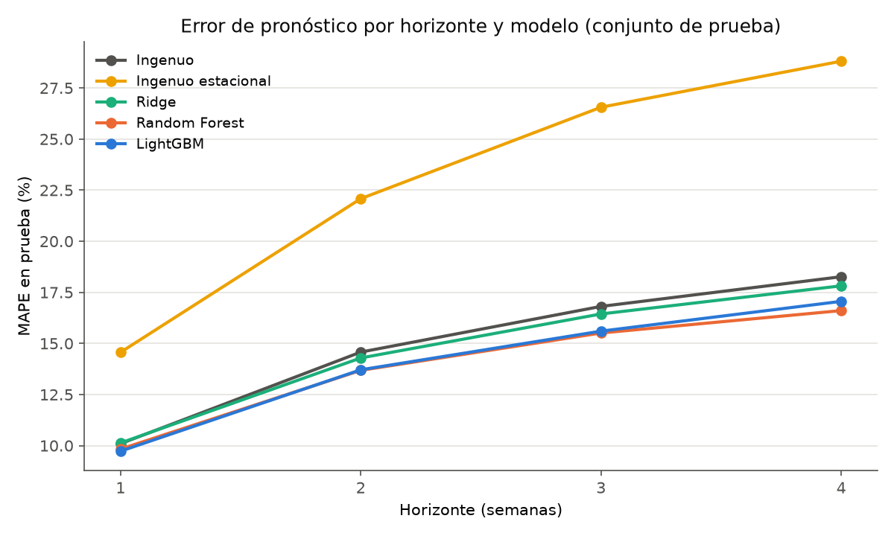
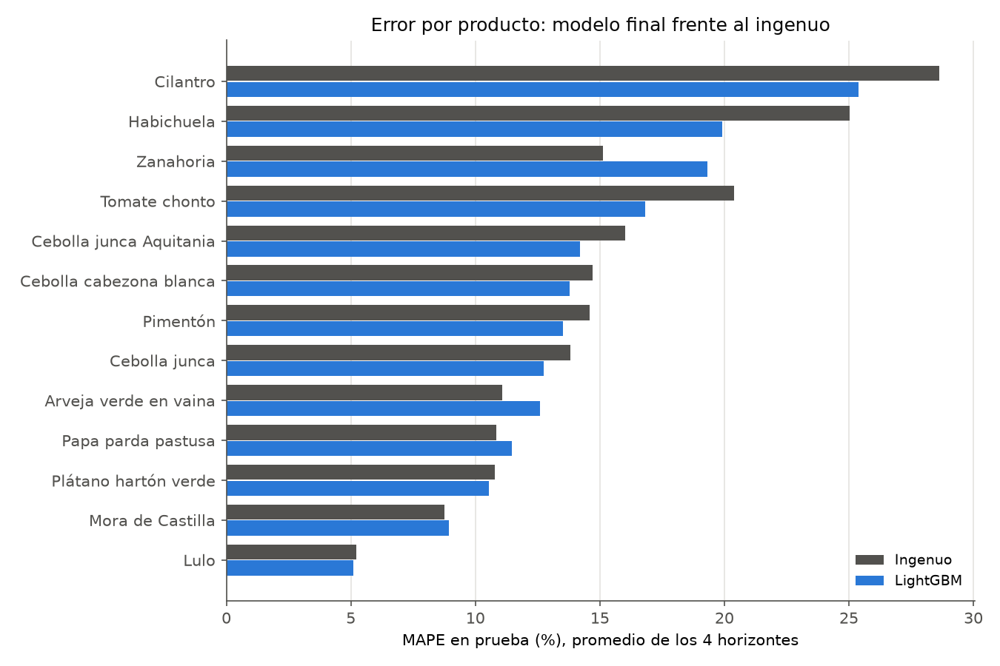
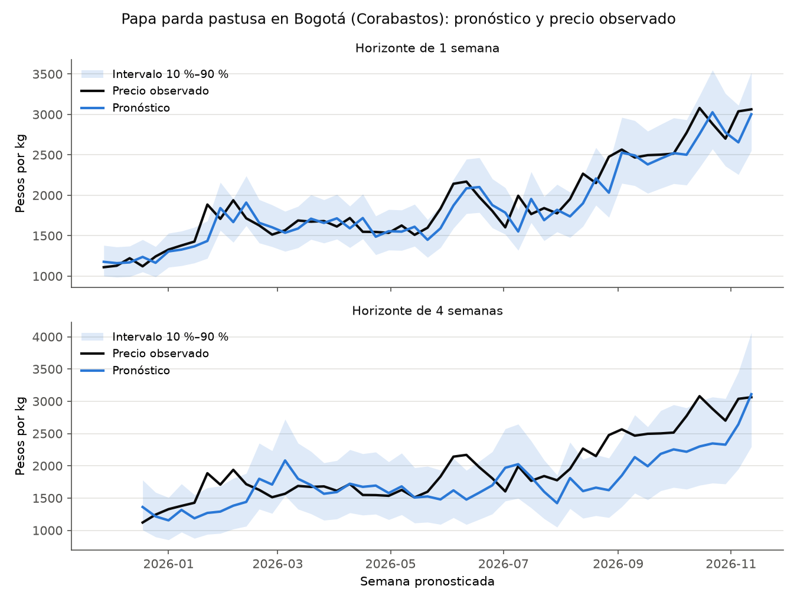
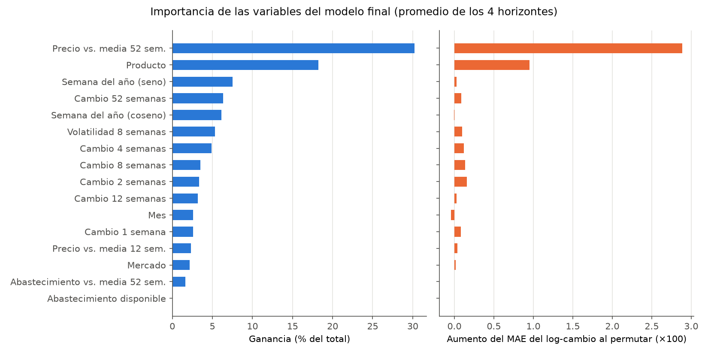

# Modelo de pronóstico de precios mayoristas

Este documento describe el modelo que pronostica el precio medio semanal mayorista de cada par producto-mercado
utilizable, 1, 2, 3 y 4 semanas hacia adelante, y lo evalúa frente a referencias simples. Las cifras corresponden al
entrenamiento del 2026-11-16 (versión `lightgbm-202611160849`) sobre la base construida el 2026-11-15, con datos hasta
la semana ISO 2026-W46. Todas se pueden comprobar en `models/metadata.json` y `models/training.log`, que genera cada
entrenamiento.

Comandos (desde la raíz del repositorio):

```bash
python -m backend.scripts.train_models        # entrena, compara, evalúa y guarda el modelo final y las figuras
python -m backend.scripts.generate_forecasts  # escribe la tabla forecasts con los modelos guardados
```

El código está en `backend/app/domains/forecasting/`: `dataset.py` (variables y objetivo), `validation.py` (partición
temporal), `estimators.py` (los cinco modelos), `metrics.py` (métricas e intervalos), `training.py` (selección y
evaluación), `forecasts.py` (modelos guardados y tabla `forecasts`) y `figures.py`.

## 1. Planteamiento del problema

- **Unidad de pronóstico**: un par producto-mercado con `usable_for_model = 1` en la tabla `coverage` (116 pares de
  13 productos y 11 mercados).
- **Serie**: precio medio semanal (`mean_price`, pesos por kilogramo) por semana ISO, desde 2016-W01.
- **Semana de origen t**: la semana en la que se hace el pronóstico; solo se usa información disponible al cierre de
  esa semana.
- **Horizontes**: h = 1, 2, 3 y 4 semanas. Se entrena **un modelo por horizonte** (estrategia directa), en lugar de
  encadenar pronósticos de una semana, para que el error de un paso no se arrastre a los siguientes.

## 2. Objetivo: log-cambio de precio

El modelo no predice el precio en pesos sino el logaritmo del cambio relativo:

```
y(t, h) = log( precio[t+h] / precio[t] )
```

Razones:

1. **Quita la tendencia inflacionaria**. Los precios están en pesos corrientes y no se deflactan (sección 9 de
   `data_pipeline.md`). El nivel de 2017 y el de 2026 son distintos, pero un cambio del 10 % en cuatro semanas
   significa lo mismo en ambos años. Un modelo entrenado sobre niveles aprendería precios que ya no existen.
2. **Pone a todos los productos en la misma escala**. El cilantro y el lulo tienen precios por kilo muy distintos; sus
   cambios relativos son comparables, así que un solo modelo puede aprender de los 116 pares.
3. **Es simétrico**: subir de 1.000 a 2.000 pesos (+0,69) y bajar de 2.000 a 1.000 (−0,69) pesan igual.

El pronóstico en pesos es `precio[t] × exp(ŷ)`. Todas las métricas y salidas se calculan en pesos.

## 3. Conjunto de datos

`dataset.py` coloca cada par en una rejilla completa de semanas ISO consecutivas, entre su primer y su último precio.
Las semanas sin boletín quedan vacías: **no se rellenan hacia adelante**. Así, un desfase de k filas es siempre un
desfase de k semanas, y cualquier variable u objetivo que necesite una semana faltante queda vacío.

- Precios de los pares utilizables desde 2016: 65.079 filas.
- Filas con todas las variables obligatorias: 56.971 (116 pares). Las primeras 52 semanas de cada par (2016) solo
  sirven para calcular el cambio a 52 semanas y la media de 52 semanas, así que las semanas de origen empiezan en
  2017-W01.
- Una fila entra en el horizonte h solo si existe el precio de la semana t + h. Si falta, la fila se descarta para ese
  horizonte (0,7 % a 1,2 % de las filas según el horizonte).

### 3.1 Variables

Todas se calculan con datos hasta la semana t, por par.

| Variable | Definición | Por qué |
|---|---|---|
| `return_1w`, `return_2w`, `return_4w`, `return_8w`, `return_12w`, `return_52w` | log(precio[t] / precio[t−k]) | Inercia y reversión de corto plazo; el cambio a 52 semanas recoge la posición en el ciclo anual |
| `price_vs_ma_12w`, `price_vs_ma_52w` | log(precio[t] / media móvil del precio en 12 o 52 semanas) | Precios muy por encima de su media tienden a volver a ella (los ciclos de siembra y cosecha) |
| `volatility_8w` | Desviación estándar de los log-cambios semanales en 8 semanas | Distingue series tranquilas de series que se mueven mucho; el error esperado depende de ella |
| `week_sin`, `week_cos` | Seno y coseno de 2π × semana ISO / 52,18 | Estacionalidad anual sin el salto artificial entre la semana 52 y la 1 |
| `month` | Mes del jueves de la semana ISO | Estacionalidad por mes, fácil de leer para los árboles |
| `supply_vs_avg_52w` | log(abastecimiento conocido / su media de 52 semanas), con el rezago de la sección 3.2 | Un ingreso de producto inusualmente alto o bajo anticipa bajadas o subidas de precio |
| `supply_available` | 1 si hay abastecimiento conocido para esa fila, 0 si no | Ver sección 3.2 |
| `product_id`, `market_id` | Categóricas | Cada producto y mercado tiene su propia dinámica (volatilidad, estacionalidad) |

Medias móviles y volatilidad exigen el 75 % de las semanas de la ventana (9 de 12, 39 de 52, 6 de 8). Las filas sin
alguna de las variables de precio o calendario se descartan.

### 3.2 Regla de fuga para el abastecimiento

El DANE publica el abastecimiento mensualmente, alrededor del día 10 del mes siguiente. En la semana t, el dato de
abastecimiento de esa misma semana todavía no existe. Para reflejar lo que de verdad se conoce:

- La variable usa el abastecimiento semanal con un **rezago de 6 semanas** (`SUPPLY_LAG_WEEKS = 6`): en la semana t
  solo se leen las semanas hasta t − 6, y la media de 52 semanas se calcula también sobre la serie rezagada.
- Por qué 6: el peor caso es una semana que empieza un mes de 31 días. Ese mes se publica hacia el día 10 del mes
  siguiente, unos 40 días después, es decir, menos de 6 semanas. Cualquier semana t − 6 o anterior ya está
  publicada en la semana t.
- La prueba `test_supply_feature_respects_publication_lag` comprueba que cambiar el abastecimiento de las semanas
  t − 5 a t no altera la variable en t, y que cambiar la semana t − 6 sí la altera.

El abastecimiento no existe para todos los pares: Cartago y Chiquinquirá no son mercados del componente de
abastecimiento, y «Mora de Castilla» y «Cebolla junca Aquitania» no se publican con ese nombre (sección 5.3 de
`data_pipeline.md`). Si el abastecimiento fuera obligatorio, esos pares saldrían del modelo. Por eso la variable es
**opcional**: cuando falta, `supply_available = 0`. LightGBM recibe el valor vacío como tal; Ridge y Random Forest lo
reciben como 0 (sin desviación de su media), junto con la marca. Alrededor del 65 % de las filas tienen abastecimiento
conocido.

## 4. Diseño de validación

Partición temporal, nunca aleatoria (`validation.py`), sobre la semana de origen:

| Conjunto | Semanas de origen | Fechas | Uso |
|---|---|---|---|
| Entrenamiento | 2017-W01 a 2024-W46 | 2017-01-02 a 2024-11-17 | Ajuste de cada modelo |
| Validación | 2024-W47 a 2025-W46 | 2024-11-18 a 2025-11-16 | Elección de hiperparámetros y del modelo final; percentiles de los intervalos |
| Prueba | 2025-W47 a 2026-W46 | 2025-11-17 a 2026-11-15 | Solo evaluación final; nunca se usa para elegir |

- La prueba son las últimas 52 semanas con precio y la validación, las 52 anteriores.
- **Sin solapamiento por el horizonte**: una fila de horizonte h también usa el precio de t + h. Las filas de
  entrenamiento cuya semana objetivo cae en la validación se descartan, y lo mismo con las de validación cuya semana
  objetivo cae en la prueba. Las semanas de origen de prueba cercanas a 2026-W46 tienen menos horizontes, porque su
  semana objetivo aún no existe.
- Filas por horizonte:

| Horizonte | Entrenamiento | Validación | Prueba |
|---|---|---|---|
| 1 | 45.008 | 5.895 | 5.427 |
| 2 | 44.858 | 5.780 | 5.389 |
| 3 | 44.710 | 5.664 | 5.273 |
| 4 | 44.628 | 5.548 | 5.157 |

Procedimiento, igual para los cinco modelos y los cuatro horizontes:

1. Cada combinación de hiperparámetros se ajusta en entrenamiento y se mide el MAPE en pesos en validación. Se queda la
   mejor por horizonte.
2. Esa combinación se reajusta con entrenamiento + validación y se evalúa en prueba.
3. El modelo final es el de menor MAPE de validación promediado sobre los cuatro horizontes.

## 5. Modelos comparados

Todos usan las mismas variables, filas y particiones, y predicen el log-cambio.

| Modelo | Descripción | Hiperparámetros |
|---|---|---|
| Ingenuo | El precio sigue igual que esta semana (ŷ = 0) | No aplica |
| Ingenuo estacional | El precio cambia en la misma proporción que cambió en las mismas semanas del año anterior: ŷ = log(precio[t−52+h] / precio[t−52]). Si falta alguno de esos precios usa ŷ = 0 (menos del 0,8 % de las filas) | No aplica |
| Ridge | Regresión lineal con penalización L2; variables numéricas estandarizadas, producto y mercado en one-hot | alpha ∈ {0,1; 1; 10; 100} |
| Random Forest | 200 árboles, `max_features = 0,5`, producto y mercado en one-hot | `max_depth` ∈ {8, 16} × `min_samples_leaf` ∈ {20, 100} |
| LightGBM | Gradient boosting con producto y mercado como categóricas nativas; `learning_rate = 0,03`, `min_child_samples = 50`, `subsample = 0,8`, `colsample_bytree = 0,8`, `reg_lambda = 1` | `num_leaves` ∈ {15, 63} × `n_estimators` ∈ {200, 600} |

Todos los modelos aleatorios usan `random_state = 42`; el entrenamiento es reproducible. Hiperparámetros elegidos en
validación:

| Modelo | h = 1 | h = 2 | h = 3 | h = 4 |
|---|---|---|---|---|
| Ridge | alpha 100 | alpha 100 | alpha 100 | alpha 100 |
| Random Forest | prof. 16, hoja 20 | prof. 16, hoja 20 | prof. 16, hoja 20 | prof. 8, hoja 20 |
| LightGBM | 63 hojas, 200 árboles | 63 hojas, 200 árboles | 15 hojas, 600 árboles | 63 hojas, 200 árboles |

## 6. Resultados

### 6.1 Selección en validación

MAPE (%) en el año de validación:

| Modelo | h = 1 | h = 2 | h = 3 | h = 4 | Promedio |
|---|---|---|---|---|---|
| Ingenuo | 10,69 | 15,96 | 19,79 | 22,06 | 17,12 |
| Ingenuo estacional | 16,13 | 22,86 | 26,93 | 29,34 | 23,82 |
| Ridge | 10,77 | 15,59 | 18,76 | 20,48 | 16,40 |
| Random Forest | 10,43 | 14,91 | 17,68 | 19,24 | 15,56 |
| **LightGBM** | **10,35** | **14,59** | **17,13** | **18,79** | **15,22** |

**Modelo elegido: LightGBM**, el de menor MAPE de validación en los cuatro horizontes y en el promedio.

### 6.2 Prueba: global

Métricas sobre las 21.246 predicciones de prueba (4 horizontes). La mejora sobre el ingenuo es
100 × (1 − error del modelo / error del ingenuo); positiva significa mejor que el ingenuo. La precisión direccional
cuenta las semanas en que el precio real cambió al menos 1 % y mide si el modelo acertó el signo; el ingenuo nunca
predice cambio, así que no aplica.

| Modelo | MAE (pesos/kg) | MAPE (%) | Precisión direccional (%) | Mejora MAE (%) | Mejora MAPE (%) |
|---|---|---|---|---|---|
| Ingenuo | 533,9 | 14,88 | No aplica | 0,0 | 0,0 |
| Ingenuo estacional | 838,7 | 22,91 | 50,9 | −57,1 | −53,9 |
| Ridge | 517,7 | 14,62 | 58,0 | 3,0 | 1,8 |
| Random Forest | 492,8 | 13,86 | 60,2 | 7,7 | 6,9 |
| **LightGBM** | **495,7** | **13,98** | **60,5** | **7,2** | **6,1** |

### 6.3 Prueba: por horizonte

| Modelo | Métrica | h = 1 | h = 2 | h = 3 | h = 4 |
|---|---|---|---|---|---|
| Ingenuo | MAPE (%) | 10,09 | 14,58 | 16,81 | 18,26 |
| | MAE | 361,8 | 521,0 | 605,7 | 655,2 |
| Ingenuo estacional | MAPE (%) | 14,56 | 22,08 | 26,56 | 28,81 |
| | MAE | 535,9 | 803,7 | 970,6 | 1.059,0 |
| Ridge | MAPE (%) | 10,13 | 14,29 | 16,44 | 17,82 |
| | MAE | 359,3 | 505,0 | 584,7 | 629,2 |
| Random Forest | MAPE (%) | 9,83 | 13,68 | 15,51 | 16,61 |
| | MAE | 349,9 | 484,7 | 553,4 | 589,5 |
| **LightGBM** | MAPE (%) | 9,73 | 13,71 | 15,60 | 17,06 |
| | MAE | 346,4 | 484,9 | 555,7 | 602,7 |
| | Precisión direccional (%) | 58,9 | 60,1 | 60,9 | 62,2 |
| | Mejora MAPE sobre el ingenuo (%) | 3,6 | 5,9 | 7,2 | 6,6 |



### 6.4 Prueba: por producto (promedio de los 4 horizontes y de los mercados)

| Producto | MAPE ingenuo (%) | MAPE LightGBM (%) | Mejora MAPE (%) | Precisión direccional LightGBM (%) |
|---|---|---|---|---|
| Papa parda pastusa | 10,83 | 11,47 | −5,9 | 48,2 |
| Cebolla cabezona blanca | 14,72 | 13,77 | 6,4 | 62,7 |
| Cebolla junca | 13,81 | 12,74 | 7,8 | 64,5 |
| Cebolla junca Aquitania | 16,00 | 14,19 | 11,3 | 70,1 |
| Tomate chonto | 20,39 | 16,82 | 17,5 | 68,7 |
| Zanahoria | 15,13 | 19,32 | −27,7 | 55,5 |
| Habichuela | 25,03 | 19,92 | 20,4 | 70,0 |
| Arveja verde en vaina | 11,06 | 12,58 | −13,7 | 52,7 |
| Plátano hartón verde | 10,79 | 10,54 | 2,4 | 53,4 |
| Cilantro | 28,62 | 25,40 | 11,3 | 67,5 |
| Mora de Castilla | 8,75 | 8,93 | −2,1 | 52,8 |
| Lulo | 5,22 | 5,11 | 2,2 | 59,4 |
| Pimentón | 14,59 | 13,50 | 7,4 | 63,2 |





### 6.5 Lectura honesta de los resultados

- **El modelo final supera al ingenuo, pero por poco**: 6,1 % menos MAPE y 7,2 % menos MAE en prueba. La mejora es
  consistente (aparece en validación y en prueba, en los cuatro horizontes y para los dos modelos de árboles), pero
  es modesta. A una semana la mejora es solo de 3,6 %: el precio de la semana siguiente se parece mucho al de esta.
  La ventaja crece con el horizonte, donde la reversión a la media y la estacionalidad tienen más tiempo de actuar.
- **No mejora en todos los productos**. Es peor que el ingenuo en zanahoria (−27,7 %), arveja verde en vaina
  (−13,7 %), papa parda pastusa (−5,9 %) y mora de Castilla (−2,1 %). En la papa de Bogotá la figura muestra por qué:
  en el horizonte de 4 semanas el modelo anticipa una reversión que no llegó durante la subida sostenida de agosto a
  octubre de 2026. Los mayores avances están en los productos más volátiles (habichuela, tomate chonto, cilantro).
- **Precisión direccional del 60,5 %**: acierta si el precio sube o baja en 3 de cada 5 semanas con cambio de al
  menos 1 %. Es mejor que el azar (50 %) pero no permite decisiones seguras por sí sola.
- **Random Forest queda un poco mejor que LightGBM en la prueba** (13,86 % contra 13,98 % de MAPE). Se conserva
  LightGBM porque la regla de elección es el error de validación, que no mira la prueba; la diferencia en prueba es
  pequeña y LightGBM entrena unas cinco veces más rápido.
- **El ingenuo estacional es mucho peor que el ingenuo**. Los ciclos de precio de estos productos no se repiten con
  la misma fecha cada año: dependen de siembras, lluvias y del fenómeno de El Niño o La Niña.

## 7. Intervalos de predicción

Para cada horizonte se calculan los residuos de validación del modelo final ajustado solo con entrenamiento,
`r = y − ŷ` (en log-cambio), y sus percentiles 10 y 90. El intervalo de una predicción es:

```
[ precio[t] × exp(ŷ + p10),  precio[t] × exp(ŷ + p90) ]
```

Es un intervalo empírico con cobertura nominal del 80 %. Percentiles y cobertura real en prueba:

| Horizonte | p10 | p90 | Ancho aproximado | Cobertura en prueba (%) |
|---|---|---|---|---|
| 1 | −0,163 | 0,159 | −15 % a +17 % | 82,2 |
| 2 | −0,238 | 0,205 | −21 % a +23 % | 80,8 |
| 3 | −0,278 | 0,240 | −24 % a +27 % | 81,5 |
| 4 | −0,303 | 0,268 | −26 % a +31 % | 81,8 |
| **Total** | | | | **81,6** |

La cobertura real está muy cerca del 80 % nominal en los cuatro horizontes: los intervalos están bien calibrados en
promedio. Son los mismos para todos los productos y mercados, así que en productos tranquilos (lulo, mora) son más
anchos de lo necesario y en los volátiles (cilantro, habichuela) más estrechos.

## 8. Importancia de las variables

Dos medidas para el modelo final, promediadas sobre los cuatro horizontes:

- **Ganancia de LightGBM**: cuánto reduce el error de entrenamiento cada variable en las divisiones de los árboles
  (porcentaje del total).
- **Importancia por permutación en la prueba**: cuánto aumenta el MAE del log-cambio al desordenar una variable en
  el conjunto de prueba (5 repeticiones). Mide lo que la variable aporta a predecir datos nuevos.

| Variable | Ganancia (%) | Permutación (aumento del MAE × 100) |
|---|---|---|
| Precio vs. media 52 semanas | 30,2 | 2,89 |
| Producto | 18,2 | 0,95 |
| Semana del año (seno) | 7,5 | 0,03 |
| Cambio 52 semanas | 6,3 | 0,09 |
| Semana del año (coseno) | 6,1 | −0,01 |
| Volatilidad 8 semanas | 5,3 | 0,10 |
| Cambio 4 semanas | 4,9 | 0,12 |
| Cambio 8 semanas | 3,5 | 0,14 |
| Cambio 2 semanas | 3,3 | 0,16 |
| Cambio 12 semanas | 3,2 | 0,03 |
| Mes | 2,6 | −0,04 |
| Cambio 1 semana | 2,6 | 0,08 |
| Precio vs. media 12 semanas | 2,3 | 0,04 |
| Mercado | 2,1 | 0,02 |
| Abastecimiento vs. media 52 semanas | 1,6 | 0,00 |
| Abastecimiento disponible | 0,0 | 0,00 |



Lectura:

- **La variable dominante es la distancia del precio a su media de 52 semanas**: cuando un producto está muy caro
  frente a su último año tiende a bajar, y al revés. Es la reversión a la media del ciclo de siembra y cosecha.
- **El producto** es la segunda: la intensidad de esa reversión y la volatilidad cambian mucho entre productos.
- Las variables de **calendario** tienen ganancia alta pero casi nada de importancia por permutación (y el mes,
  ligeramente negativa): el modelo las usa en entrenamiento, pero en el año de prueba la estacionalidad no se repitió
  como en el pasado. Es coherente con el mal resultado del ingenuo estacional.
- **El abastecimiento rezagado no aporta** en la prueba. Con 6 semanas de rezago, el dato llega cuando el precio ya
  reaccionó; el abastecimiento útil para pronosticar sería el de la semana en curso, que no se conoce a tiempo.

## 9. Salidas

- **Modelos**: `models/forecast_h1.joblib` a `forecast_h4.joblib` (excluidos de git) y `models/metadata.json`, con el
  tipo de modelo, la versión, los horizontes, las variables, las fechas de cada partición, los hiperparámetros, los
  percentiles de los intervalos, las métricas de validación y de prueba, la importancia de las variables (ganancia y
  permutación) y la fecha de creación. La API lee este archivo en `/api/model/summary`. Los modelos guardados
  son los evaluados en la prueba, ajustados con entrenamiento + validación (datos hasta 2025-W46).
- **Tabla `forecasts`** en `mercao.db`: `product_id`, `market_id`, `origin_iso_year`, `origin_iso_week`, `horizon`,
  `target_iso_year`, `target_iso_week`, `target_week_start`, `predicted_price`, `lower_price`, `upper_price`,
  `model_version`. La semana objetivo es la semana de origen más `horizon` semanas; `target_week_start` es su lunes.
  Para cada uno de los 116 pares se toma su última semana con todas las variables (2026-W46 para todos en esta
  versión, así que las semanas objetivo van de 2026-W47 a 2026-W50) y se pronostican los 4 horizontes: 464 filas.
  La tabla se borra y se vuelve a crear en cada ejecución de `generate_forecasts`.
- **Reconstrucción de la base**: `build_database` reemplaza el archivo `mercao.db`, así que al terminar regenera la
  tabla `forecasts` con los modelos guardados en `models/` y lo registra en el log y en `build_summary.json`
  (`forecast_rows`). Si no hay modelos entrenados, el log lo advierte y la tabla queda sin generar hasta ejecutar
  `train_models` y `generate_forecasts`.
- **Figuras** en `docs/figures/`: `forecast_model_comparison.png`, `forecast_potato_bogota.png`,
  `forecast_feature_importance.png` y `forecast_error_by_product.png`.

Tiempo de entrenamiento completo (construcción del conjunto, búsqueda de hiperparámetros, reajuste, evaluación,
importancias y figuras): **161 s**. Por modelo, sumando búsqueda y reajuste de los 4 horizontes: Random Forest 118 s,
LightGBM 23 s, Ridge 1,4 s.

## 10. Limitaciones

- **Mejora modesta**: el modelo gana al ingenuo por 6 % de MAPE en promedio y pierde en 4 de 13 productos. Para esos
  productos, el precio de esta semana es una referencia igual o mejor.
- **Una sola partición de prueba**: los resultados vienen de un año (noviembre de 2025 a noviembre de 2026). Un año
  con otro régimen climático podría dar otra comparación. Una validación con origen móvil (varios años de prueba)
  daría una estimación más estable.
- **Intervalos iguales para todos los pares**: los percentiles se calculan por horizonte, no por producto, así que su
  cobertura es correcta en promedio pero no en cada producto.
- **Grilla pequeña de hiperparámetros**: Ridge eligió el alpha mayor de la grilla y LightGBM y Random Forest los
  árboles más complejos en varios horizontes. Ampliar la grilla podría mejorar algo, a costa de más tiempo.
- **Abastecimiento**: falta para el 35 % de las filas (mercados y variedades que el componente de abastecimiento no
  cubre) y el rezago de 6 semanas le quita casi todo su valor. Los microdatos se publican además como archivos
  anuales; el rezago supone la publicación mensual del boletín.
- **Precios corrientes y boletines de festivos**: el log-cambio neutraliza la inflación en el horizonte de 4 semanas,
  pero las semanas de festivos (boletines de 4 a 9 días) siguen siendo menos comparables.
- **Semanas faltantes**: una semana sin precio elimina las filas que la necesitan, sin imputarla. Esto no sesga el
  objetivo, pero reduce algo el número de filas.
- **Variables externas**: no se usan clima, precio de insumos, tasa de cambio ni fenómenos de El Niño o La Niña, que
  explican buena parte de los grandes movimientos de precio.
